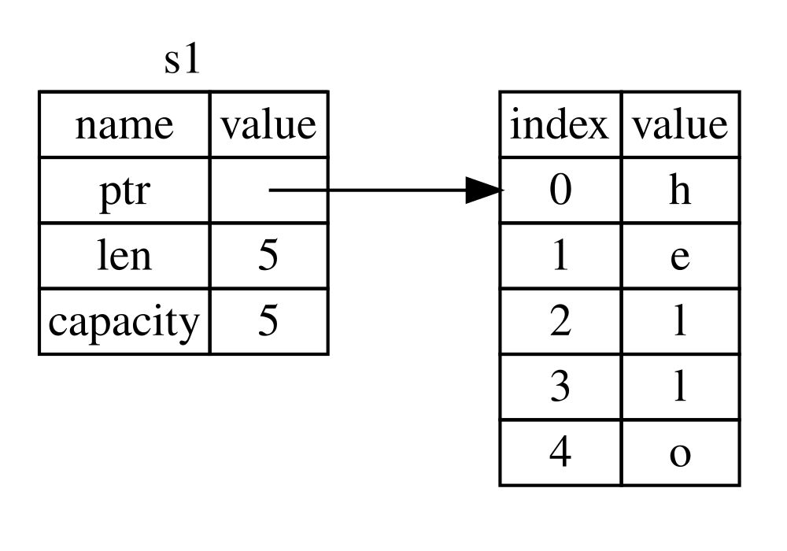
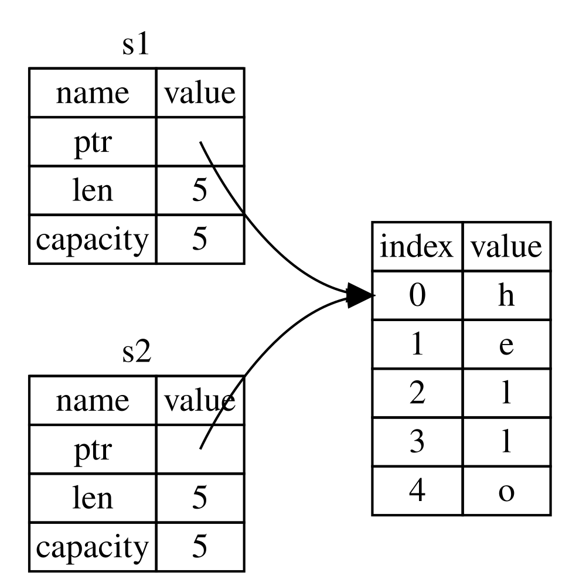
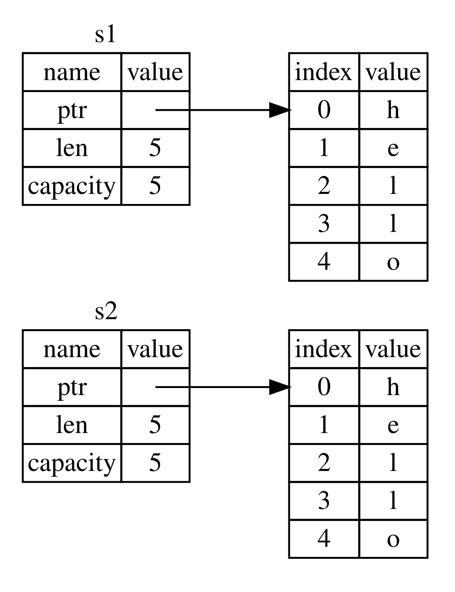
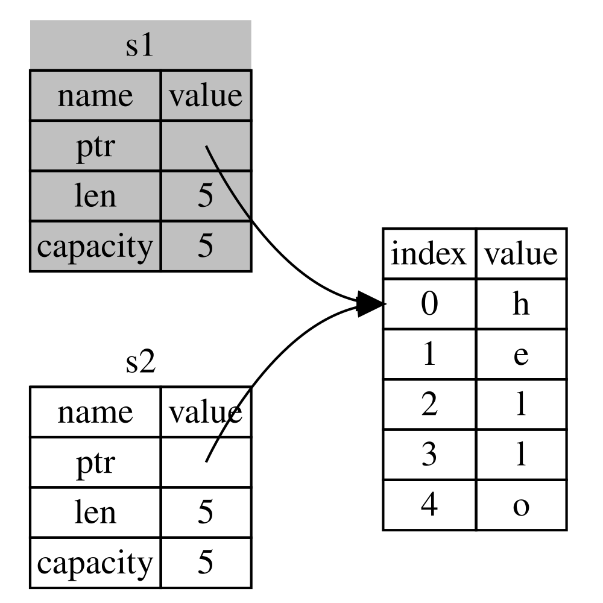
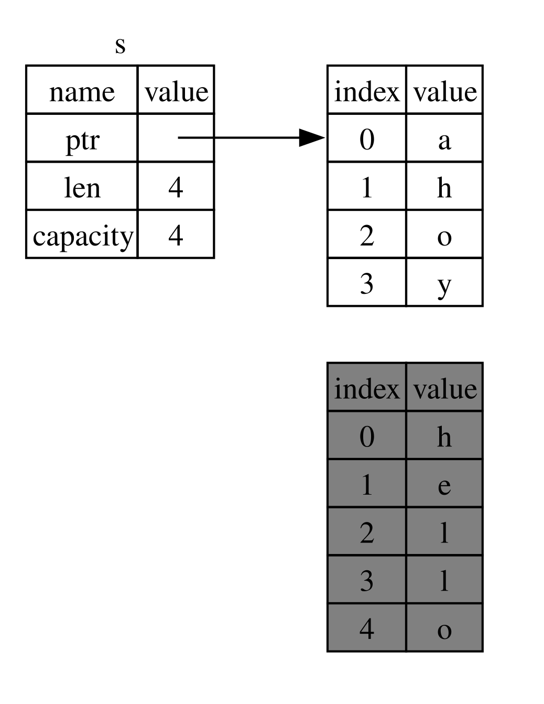

## Qu’est-ce que la propriété ?

La _propriété_ est un ensemble de règles qui régissent la manière dont un programme Rust gère la mémoire.
Tous les programmes doivent gérer la façon dont ils utilisent la mémoire d’un ordinateur pendant leur exécution.
Certains langages disposent d’un ramasse-miettes qui recherche régulièrement la mémoire qui n’est plus utilisée pendant l’exécution du programme ; dans d’autres langages, le programmeur doit allouer et libérer explicitement la mémoire. Rust adopte une troisième approche : la mémoire est gérée au moyen d’un système de propriété assorti d’un ensemble de règles vérifiées par le compilateur. Si l’une de ces règles est enfreinte, le programme ne compilera pas. Aucune des fonctionnalités de la propriété ne ralentira votre programme pendant son exécution.

Comme la propriété est un concept nouveau pour de nombreux programmeurs, il faut un certain temps pour s’y habituer. La bonne nouvelle, c’est que plus vous gagnerez en expérience avec Rust et les règles du système de propriété, plus il vous sera facile d’écrire naturellement du code sûr et efficace. Persévérez !

Lorsque vous comprendrez la propriété, vous disposerez d’une base solide pour comprendre les fonctionnalités qui rendent Rust unique. Dans ce chapitre, vous découvrirez la propriété à travers des exemples portant sur une structure de données très courante : les chaînes de caractères.

> ### La pile et le tas
>
> Beaucoup de langages de programmation ne vous obligent pas à réfléchir souvent à la pile et au tas. Mais dans un langage de programmation système comme Rust, le fait qu’une valeur se trouve sur la pile ou sur le tas influe sur le comportement du langage et explique pourquoi vous devez prendre certaines décisions. Certaines parties de la propriété seront décrites en lien avec la pile et le tas plus loin dans ce chapitre ; voici donc une brève explication pour vous y préparer.
>
> La pile et le tas sont tous deux des zones de mémoire que votre code peut utiliser à l’exécution, mais leur organisation diffère. La pile stocke les valeurs dans l’ordre où elles y sont ajoutées et les retire dans l’ordre inverse. C’est ce qu’on appelle le principe du _dernier entré, premier sorti (LIFO)_. Imaginez une pile d’assiettes : lorsque vous en ajoutez, vous les posez au sommet de la pile ; lorsque vous en avez besoin, vous en prenez une au sommet. Ajouter ou retirer des assiettes au milieu ou au bas de la pile ne serait pas aussi pratique ! L’ajout de données s’appelle _empiler sur la pile_, et leur retrait s’appelle _dépiler_. Toutes les données stockées sur la pile doivent avoir une taille connue et fixe. Les données dont la taille est inconnue à la compilation ou susceptible de changer doivent plutôt être stockées sur le tas.
>
> Le tas est moins organisé : lorsque vous y placez des données, vous demandez un certain espace. L’allocateur de mémoire trouve un emplacement libre sur le tas suffisamment grand, le marque comme utilisé et renvoie un _pointeur_, c’est-à-dire l’adresse de cet emplacement. Ce processus s’appelle _allouer sur le tas_, ou plus simplement _allouer_ (empiler des valeurs ne constitue pas une allocation). Comme le pointeur vers le tas a une taille connue et fixe, vous pouvez stocker ce pointeur sur la pile ; mais pour accéder aux données proprement dites, vous devez suivre le pointeur. Imaginez que vous soyez assis dans un restaurant. À votre arrivée, vous indiquez le nombre de personnes de votre groupe, puis l’hôte trouve une table libre pouvant accueillir tout le monde et vous y conduit. Si quelqu’un de votre groupe arrive en retard, il peut demander où vous êtes installés pour vous retrouver.
>
> Empiler des données est plus rapide que les allouer sur le tas, car l’allocateur n’a jamais à chercher où stocker les nouvelles données : cet emplacement se trouve toujours au sommet de la pile. En comparaison, allouer de l’espace sur le tas demande plus de travail, car l’allocateur doit d’abord trouver un espace suffisamment grand pour contenir les données, puis effectuer des opérations de gestion pour préparer la prochaine allocation.
>
> L’accès aux données sur le tas est généralement plus lent que l’accès aux données sur la pile, car vous devez suivre un pointeur pour y accéder. Les processeurs modernes sont plus rapides lorsqu’ils ont moins besoin de parcourir la mémoire. Pour poursuivre l’analogie, imaginez un serveur de restaurant qui prend les commandes de nombreuses tables. Le plus efficace est de prendre toutes les commandes d’une table avant de passer à la suivante. Prendre une commande à la table A, puis une à la table B, puis de nouveau une à la table A et ensuite à la table B serait beaucoup plus lent. De même, un processeur travaille généralement mieux sur des données proches les unes des autres (comme celles stockées sur la pile) que sur des données plus éloignées (comme celles qui peuvent se trouver sur le tas).
>
> Lorsque votre code appelle une fonction, les valeurs qui lui sont transmises (y compris, éventuellement, des pointeurs vers des données sur le tas) ainsi que les variables locales de la fonction sont empilées. Lorsque la fonction se termine, ces valeurs sont dépilées.
>
> Suivre les parties du code qui utilisent les données sur le tas, réduire au minimum la quantité de données dupliquées sur le tas et nettoyer les données qui ne sont plus utilisées afin de ne pas manquer d’espace sont autant de problèmes auxquels la propriété apporte une solution. Une fois que vous aurez compris la propriété, vous n’aurez pas souvent besoin de réfléchir à la pile et au tas. Mais savoir que l’objectif principal de la propriété est de gérer les données sur le tas peut vous aider à comprendre son fonctionnement.

### Règles de propriété

Commençons par examiner les règles de propriété. Gardez-les à l’esprit à mesure que nous parcourons les exemples qui les illustrent :

- Chaque valeur en Rust a un _propriétaire_.
- Il ne peut y avoir qu’un seul propriétaire à la fois.
- Lorsque le propriétaire sort de sa portée, la valeur est supprimée.

### Portée des variables

Maintenant que nous avons dépassé la syntaxe de base de Rust, nous n’inclurons plus tout le code `fn main() {` dans les exemples. Si vous les reproduisez, veillez donc à insérer manuellement les exemples suivants dans une fonction `main`. Nos exemples seront ainsi un peu plus concis, ce qui nous permettra de nous concentrer sur les détails plutôt que sur le code standard.

Pour commencer à étudier la propriété, examinons la portée de quelques variables. Une _portée_ est la plage d’un programme pendant laquelle un élément est valide. Prenons la variable suivante :

```rust
let s = "hello";
```

La variable `s` fait référence à une chaîne littérale, dont la valeur est codée en dur dans le texte de notre programme. La variable est valide à partir du moment où elle est déclarée et jusqu’à la fin de la portée actuelle. La liste 4-1 montre un programme contenant des commentaires qui indiquent les endroits où la variable `s` serait valide.

<Listing number="4-1" caption="Une variable et la portée dans laquelle elle est valide">

```rust
{{#rustdoc_include ../listings/ch04-understanding-ownership/listing-04-01/src/main.rs:here}}
```

</Listing>

En d’autres termes, deux moments importants sont à retenir :

- Lorsque `s` _entre_ dans sa portée, elle est valide.
- Elle le reste jusqu’à ce qu’elle _sorte de_ sa portée.

À ce stade, le lien entre les portées et la période de validité des variables ressemble à celui que l’on trouve dans d’autres langages de programmation. Nous allons maintenant approfondir cette notion en présentant le type `String`.

### Le type `String`

Pour illustrer les règles de propriété, nous avons besoin d’un type de données plus complexe que ceux présentés dans la section [« Types de données »][data-types]<!-- ignore --> du chapitre 3. Les types abordés précédemment ont une taille connue, peuvent être stockés sur la pile et dépilés lorsque leur portée prend fin, et peuvent être copiés rapidement et simplement pour créer une nouvelle instance indépendante si une autre partie du code doit utiliser la même valeur dans une portée différente. Mais nous voulons étudier des données stockées sur le tas et voir comment Rust sait quand les nettoyer ; le type `String` en est un excellent exemple.

Nous nous concentrerons sur les aspects de `String` qui concernent la propriété. Ces aspects s’appliquent également à d’autres types de données complexes, qu’ils soient fournis par la bibliothèque standard ou créés par vous. Nous parlerons des aspects de `String` qui ne concernent pas la propriété au [chapitre 8][ch8]<!-- ignore -->.

Nous avons déjà vu les chaînes littérales, dont la valeur est codée en dur dans notre programme. Les chaînes littérales sont pratiques, mais elles ne conviennent pas à toutes les situations où nous pourrions vouloir utiliser du texte. L’une des raisons est qu’elles sont immuables. Une autre est que nous ne pouvons pas connaître toutes les valeurs de chaîne au moment où nous écrivons notre code : par exemple, que faire si nous voulons récupérer et stocker des données saisies par l’utilisateur ? C’est pour ce genre de situations que Rust propose le type `String`. Ce type gère des données allouées sur le tas et peut donc stocker une quantité de texte dont la taille nous est inconnue à la compilation. Vous pouvez créer une `String` à partir d’une chaîne littérale à l’aide de la fonction `from`, comme ceci :

```rust
let s = String::from("hello");
```

L’opérateur à deux deux-points `::` nous permet de placer cette fonction `from` particulière dans l’espace de noms du type `String`, plutôt que d’utiliser un nom quelconque comme `string_from`. Nous reviendrons plus en détail sur cette syntaxe dans la section [« Méthodes »][methods]<!-- ignore --> du chapitre 5, ainsi que lorsque nous aborderons les espaces de noms avec les modules dans la section [« Chemins pour faire référence à un élément de l’arborescence des modules »][paths-module-tree]<!-- ignore --> du chapitre 7.

Ce type de chaîne _peut_ être modifié :

```rust
{{#rustdoc_include ../listings/ch04-understanding-ownership/no-listing-01-can-mutate-string/src/main.rs:here}}
```

Quelle est donc la différence ? Pourquoi peut-on modifier une `String`, mais pas les chaînes littérales ? La différence tient à la manière dont ces deux types gèrent la mémoire.

### Mémoire et allocation

Dans le cas d’une chaîne littérale, nous en connaissons le contenu à la compilation ; le texte est donc directement codé en dur dans l’exécutable final. C’est pourquoi les chaînes littérales sont rapides et efficaces. Mais ces propriétés sont uniquement possibles parce que les chaînes littérales sont immuables. Malheureusement, nous ne pouvons pas intégrer dans le binaire un bloc de mémoire pour chaque texte dont la taille est inconnue à la compilation et susceptible de changer pendant l’exécution du programme.

Avec le type `String`, pour pouvoir gérer un texte modifiable et extensible, nous devons allouer sur le tas une quantité de mémoire dont la taille est inconnue à la compilation afin d’y stocker le contenu. Cela signifie que :

- La mémoire doit être demandée à l’allocateur de mémoire à l’exécution.
- Nous devons pouvoir restituer cette mémoire à l’allocateur lorsque nous n’avons plus besoin de notre `String`.

Nous nous chargeons de la première partie : lorsque nous appelons `String::from`, son implémentation demande la mémoire dont elle a besoin. C’est à peu près la norme dans les langages de programmation.

La seconde partie, en revanche, est différente. Dans les langages qui disposent d’un _ramasse-miettes (GC)_, celui-ci suit et nettoie la mémoire qui n’est plus utilisée ; nous n’avons donc pas à nous en préoccuper. Dans la plupart des langages dépourvus de ramasse-miettes, il nous revient de déterminer quand la mémoire n’est plus utilisée et d’appeler du code pour la libérer explicitement, comme nous l’avons fait pour la demander. Historiquement, effectuer cette opération correctement a été un problème de programmation difficile. Si nous l’oublions, nous gaspillons de la mémoire. Si nous la faisons trop tôt, nous nous retrouvons avec une variable invalide. Si nous la faisons deux fois, c’est aussi une erreur. Nous devons associer exactement un `allocate` à exactement un `free`.

Rust adopte une approche différente : la mémoire est automatiquement restituée lorsque la variable qui en est propriétaire sort de sa portée. Voici une version de notre exemple sur les portées de la liste 4-1 utilisant une `String` au lieu d’une chaîne littérale :

```rust
{{#rustdoc_include ../listings/ch04-understanding-ownership/no-listing-02-string-scope/src/main.rs:here}}
```

Il existe un moment naturel auquel nous pouvons restituer à l’allocateur la mémoire dont notre `String` a besoin : lorsque `s` sort de sa portée. Lorsqu’une variable sort de sa portée, Rust appelle pour nous une fonction spéciale. Cette fonction s’appelle `drop`, et c’est là que l’auteur de `String` peut placer le code qui restitue la mémoire. Rust appelle automatiquement `drop` à l’accolade fermante.

> Remarque : en C++, ce modèle de libération des ressources à la fin de la durée de vie d’un élément est parfois appelé _Resource Acquisition Is Initialization (RAII)_. Si vous avez déjà utilisé des modèles RAII, la fonction `drop` de Rust vous sera familière.

Ce modèle a une incidence profonde sur la manière d’écrire du code Rust. Il peut sembler simple pour l’instant, mais le comportement du code peut surprendre dans des situations plus complexes, lorsque nous voulons que plusieurs variables utilisent les données que nous avons allouées sur le tas. Examinons maintenant quelques-unes de ces situations.

<!-- Old headings. Do not remove or links may break. -->

<a id="ways-variables-and-data-interact-move"></a>

#### Interaction entre variables et données avec le déplacement

En Rust, plusieurs variables peuvent interagir de différentes manières avec les mêmes données. La liste 4-2 présente un exemple avec un entier.

<Listing number="4-2" caption="Affectation de la valeur entière de la variable `x` à `y`">

```rust
{{#rustdoc_include ../listings/ch04-understanding-ownership/listing-04-02/src/main.rs:here}}
```

</Listing>

Nous pouvons probablement deviner ce que fait ce code : « Lier la valeur `5` à `x`, puis copier la valeur de `x` et la lier à `y`. » Nous avons maintenant deux variables, `x` et `y`, qui valent toutes deux `5`. C’est bien ce qui se passe, car les entiers sont des valeurs simples dont la taille est connue et fixe ; ces deux valeurs `5` sont donc empilées.

Examinons maintenant la version avec `String` :

```rust
{{#rustdoc_include ../listings/ch04-understanding-ownership/no-listing-03-string-move/src/main.rs:here}}
```

Cela semble très similaire ; nous pourrions donc supposer que le fonctionnement est le même : autrement dit, la deuxième ligne ferait une copie de la valeur de `s1` et la lierait à `s2`. Mais ce n’est pas tout à fait ce qui se passe.

Examinez la figure 4-1 pour voir ce qui se passe en coulisses avec `String`. Une `String` se compose de trois éléments, représentés à gauche : un pointeur vers la mémoire qui contient le contenu de la chaîne, une longueur et une capacité. Ce groupe de données est stocké sur la pile. À droite se trouve la mémoire sur le tas qui contient le contenu.



<span class="caption">Figure 4-1 : Représentation en mémoire d’une `String` contenant la valeur `"hello"` liée à `s1`</span>

La longueur correspond à la quantité de mémoire, en octets, actuellement utilisée par le contenu de la `String`. La capacité correspond à la quantité totale de mémoire, en octets, que la `String` a reçue de l’allocateur. La différence entre la longueur et la capacité est importante, mais pas dans ce contexte ; pour l’instant, vous pouvez donc ignorer la capacité.

Lorsque nous affectons `s1` à `s2`, les données de `String` sont copiées, c’est-à-dire que nous copions le pointeur, la longueur et la capacité qui se trouvent sur la pile. Nous ne copions pas les données sur le tas vers lesquelles pointe le pointeur. En d’autres termes, la représentation des données en mémoire ressemble à la figure 4-2.



<span class="caption">Figure 4-2 : Représentation en mémoire de la variable `s2`, qui contient une copie du pointeur, de la longueur et de la capacité de `s1`</span>

La représentation ne ressemble _pas_ à la figure 4-3, qui montre l’apparence qu’aurait la mémoire si Rust copiait également les données du tas. Si Rust faisait cela, l’opération `s2 = s1` pourrait être très coûteuse en termes de performances à l’exécution si les données sur le tas étaient volumineuses.



<span class="caption">Figure 4-3 : Autre représentation possible de `s2 = s1` si Rust copiait également les données du tas</span>

Nous avons dit précédemment que lorsqu’une variable sort de sa portée, Rust appelle automatiquement la fonction `drop` et nettoie la mémoire du tas associée à cette variable. Mais la figure 4-2 montre les deux pointeurs de données pointant vers le même emplacement. C’est un problème : lorsque `s2` et `s1` sortiront de leur portée, elles tenteront toutes deux de libérer la même mémoire. C’est ce qu’on appelle une erreur de _double libération_, l’un des bogues de sûreté mémoire mentionnés précédemment. Libérer la mémoire deux fois peut entraîner une corruption de la mémoire, ce qui peut créer des failles de sécurité.

Pour garantir la sûreté mémoire, après la ligne `let s2 = s1;`, Rust considère que `s1` n’est plus valide. Rust n’a donc rien à libérer lorsque `s1` sort de sa portée. Voyez ce qui se passe lorsque vous essayez d’utiliser `s1` après la création de `s2` : cela ne fonctionnera pas :

```rust,ignore,does_not_compile
{{#rustdoc_include ../listings/ch04-understanding-ownership/no-listing-04-cant-use-after-move/src/main.rs:here}}
```

Vous obtiendrez une erreur de ce type, car Rust vous empêche d’utiliser la référence invalidée :

```console
{{#include ../listings/ch04-understanding-ownership/no-listing-04-cant-use-after-move/output.txt}}
```

Si vous avez déjà rencontré les termes _copie superficielle_ et _copie profonde_ dans d’autres langages, la notion de copie du pointeur, de la longueur et de la capacité sans copier les données vous fait probablement penser à une copie superficielle. Mais comme Rust invalide également la première variable, on ne parle pas de copie superficielle, mais de _déplacement_. Dans cet exemple, nous dirions que `s1` a été _déplacée_ dans `s2`. Ce qui se passe réellement est illustré à la figure 4-4.



<span class="caption">Figure 4-4 : Représentation en mémoire après l’invalidation de `s1`</span>

Notre problème est ainsi résolu ! Comme seule `s2` est valide, c’est elle seule qui libérera la mémoire en sortant de sa portée, et le problème est réglé.

En outre, cela implique un choix de conception : Rust ne crée jamais automatiquement de copies « profondes » de vos données. On peut donc supposer que toute copie _automatique_ est peu coûteuse en termes de performances à l’exécution.

#### Portée et affectation

L’inverse est également vrai pour le lien entre la portée, la propriété et la libération de la mémoire via la fonction `drop`. Lorsque vous affectez une valeur entièrement nouvelle à une variable existante, Rust appelle `drop` et libère immédiatement la mémoire de la valeur d’origine. Considérez par exemple le code suivant :

```rust
{{#rustdoc_include ../listings/ch04-understanding-ownership/no-listing-04b-replacement-drop/src/main.rs:here}}
```

Nous déclarons d’abord une variable `s` et la lions à une `String` dont la valeur est `"hello"`. Puis, nous créons immédiatement une nouvelle `String` de valeur `"ahoy"` et l’affectons à `s`. À ce stade, plus rien ne fait référence à la valeur d’origine sur le tas. La figure 4-5 illustre maintenant les données sur la pile et le tas :



<span class="caption">Figure 4-5 : Représentation en mémoire après le remplacement complet de la valeur initiale</span>

La chaîne d’origine sort donc immédiatement de sa portée. Rust exécute sa fonction `drop` et sa mémoire est aussitôt libérée. Lorsque nous afficherons la valeur à la fin, ce sera `"ahoy, world!"`.

<!-- Old headings. Do not remove or links may break. -->

<a id="ways-variables-and-data-interact-clone"></a>

#### Interaction entre variables et données avec `clone`

Si nous voulons vraiment copier en profondeur les données de `String` sur le tas, et pas seulement les données de la pile, nous pouvons utiliser une méthode courante appelée `clone`. Nous aborderons la syntaxe des méthodes au chapitre 5, mais comme les méthodes sont courantes dans de nombreux langages de programmation, vous en avez probablement déjà vu.

Voici un exemple d’utilisation de la méthode `clone` :

```rust
{{#rustdoc_include ../listings/ch04-understanding-ownership/no-listing-05-clone/src/main.rs:here}}
```

Cela fonctionne parfaitement et produit explicitement le comportement illustré à la figure 4-3, où les données du tas sont bien copiées.

Lorsque vous voyez un appel à `clone`, vous savez qu’un code quelconque est exécuté et qu’il peut être coûteux. C’est un indicateur visuel qu’une opération différente est en cours.

#### Données uniquement sur la pile : `Copy`

Il y a un autre détail dont nous n’avons pas encore parlé. Ce code utilisant des entiers — dont une partie figurait dans la liste 4-2 — fonctionne et est valide :

```rust
{{#rustdoc_include ../listings/ch04-understanding-ownership/no-listing-06-copy/src/main.rs:here}}
```

Mais ce code semble contredire ce que nous venons d’apprendre : nous n’appelons pas `clone`, pourtant `x` reste valide et n’a pas été déplacée dans `y`.

La raison est que les types tels que les entiers, dont la taille est connue à la compilation, sont entièrement stockés sur la pile ; les copies des valeurs proprement dites sont donc rapides à effectuer. Rien ne justifie alors d’empêcher `x` de rester valide après la création de la variable `y`. En d’autres termes, il n’y a ici aucune différence entre une copie profonde et une copie superficielle. Appeler `clone` ne ferait rien de différent de la copie superficielle habituelle ; nous pouvons donc nous en passer.

Rust propose une annotation spéciale appelée le trait `Copy`, que nous pouvons appliquer aux types stockés sur la pile, comme les entiers (nous parlerons plus en détail des traits au [chapitre 10][traits]<!-- ignore -->). Si un type implémente le trait `Copy`, les variables qui l’utilisent ne sont pas déplacées, mais simplement copiées ; elles restent donc valides après leur affectation à une autre variable.

Rust ne nous permet pas d’annoter un type avec `Copy` si ce type, ou l’un de ses éléments, implémente le trait `Drop`. Si le type nécessite un traitement particulier lorsque la valeur sort de sa portée et que nous ajoutons l’annotation `Copy` à ce type, nous obtiendrons une erreur à la compilation. Pour savoir comment ajouter l’annotation `Copy` à votre type afin d’implémenter le trait, consultez la section [« Traits dérivables »][derivable-traits]<!-- ignore --> de l’annexe C.

Quels types implémentent donc le trait `Copy` ? Vous pouvez consulter la documentation du type en question pour en être sûr, mais en règle générale, tout groupe de valeurs scalaires simples peut implémenter `Copy`, tandis qu’aucun type nécessitant une allocation ou représentant une forme de ressource ne le peut. Voici quelques types qui implémentent `Copy` :

- Tous les types entiers, comme `u32`.
- Le type booléen `bool`, dont les valeurs sont `true` et `false`.
- Tous les types à virgule flottante, comme `f64`.
- Le type caractère `char`.
- Les tuples, s’ils ne contiennent que des types qui implémentent également `Copy`. Par exemple, `(i32, i32)` implémente `Copy`, mais `(i32, String)` ne l’implémente pas.

### Propriété et fonctions

Le fonctionnement du transfert d’une valeur à une fonction est similaire à celui de l’affectation d’une valeur à une variable. Transmettre une variable à une fonction entraîne son déplacement ou sa copie, tout comme une affectation. La liste 4-3 présente un exemple avec des annotations indiquant où les variables entrent dans leur portée et en sortent.

<Listing number="4-3" file-name="src/main.rs" caption="Fonctions annotées avec les règles de propriété et de portée">

```rust
{{#rustdoc_include ../listings/ch04-understanding-ownership/listing-04-03/src/main.rs}}
```

</Listing>

Si nous essayions d’utiliser `s` après l’appel à `takes_ownership`, Rust déclencherait une erreur à la compilation. Ces vérifications statiques nous protègent contre les erreurs. Essayez d’ajouter à `main` du code qui utilise `s` et `x` pour voir où vous pouvez les utiliser et où les règles de propriété vous en empêchent.

### Valeurs de retour et portée

Le renvoi de valeurs peut également transférer la propriété. La liste 4-4 présente un exemple de fonction qui renvoie une valeur, avec des annotations similaires à celles de la liste 4-3.

<Listing number="4-4" file-name="src/main.rs" caption="Transfert de la propriété des valeurs de retour">

```rust
{{#rustdoc_include ../listings/ch04-understanding-ownership/listing-04-04/src/main.rs}}
```

</Listing>

La propriété d’une variable suit toujours le même schéma : affecter une valeur à une autre variable la déplace. Lorsqu’une variable qui contient des données sur le tas sort de sa portée, la valeur est nettoyée par `drop`, sauf si la propriété des données a été transférée à une autre variable.

Même si cela fonctionne, prendre la propriété puis la rendre à chaque appel de fonction est un peu fastidieux. Et si nous voulons laisser une fonction utiliser une valeur sans lui en transférer la propriété ? Il est assez agaçant de devoir également récupérer tout ce que nous transmettons si nous voulons le réutiliser, en plus des données produites par le corps de la fonction que nous pourrions aussi vouloir renvoyer.

Rust nous permet de renvoyer plusieurs valeurs au moyen d’un tuple, comme le montre la liste 4-5.

<Listing number="4-5" file-name="src/main.rs" caption="Renvoi de la propriété des paramètres">

```rust
{{#rustdoc_include ../listings/ch04-understanding-ownership/listing-04-05/src/main.rs}}
```

</Listing>

Mais cela entraîne trop de formalités et de travail pour un concept qui devrait être courant. Heureusement, Rust dispose d’une fonctionnalité qui permet d’utiliser une valeur sans en transférer la propriété : les références.

[data-types]: ch03-02-data-types.html#data-types
[ch8]: ch08-02-strings.html
[traits]: ch10-02-traits.html
[derivable-traits]: appendix-03-derivable-traits.html
[methods]: ch05-03-method-syntax.html#methods
[paths-module-tree]: ch07-03-paths-for-referring-to-an-item-in-the-module-tree.html