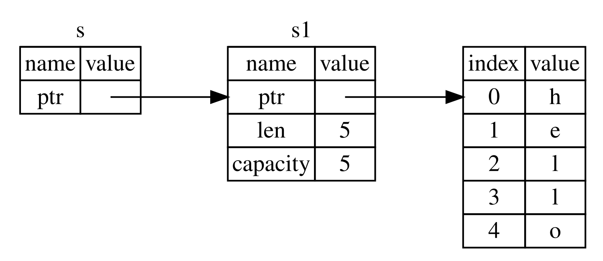

## Références et emprunts

Le problème avec le code utilisant un tuple dans l’exemple 4-5 est que nous devons renvoyer la `String` à la fonction appelante afin de pouvoir encore utiliser la `String` après l’appel à `calculate_length`, car la `String` a été déplacée dans `calculate_length`. À la place, nous pouvons fournir une référence à la valeur `String`. Une référence est comme un pointeur, en ce sens qu’il s’agit d’une adresse que nous pouvons suivre pour accéder aux données stockées à cette adresse ; ces données appartiennent à une autre variable. Contrairement à un pointeur, une référence garantit de pointer vers une valeur valide d’un type particulier pendant toute la durée de vie de cette référence.

Voici comment définir et utiliser une fonction `calculate_length` qui prend une référence à un objet comme paramètre au lieu de prendre possession de la valeur :

<Listing file-name="src/main.rs">

```rust
{{#rustdoc_include ../listings/ch04-understanding-ownership/no-listing-07-reference/src/main.rs:all}}
```

</Listing>

Tout d’abord, remarquez que tout le code utilisant un tuple dans la déclaration de variable et la valeur de retour de la fonction a disparu. Ensuite, notez que nous passons `&s1` à `calculate_length` et que, dans sa définition, nous prenons `&String` plutôt que `String`. Ces esperluettes représentent des références et vous permettent de faire référence à une valeur sans en prendre possession. La figure 4-6 illustre ce concept.



<span class="caption">Figure 4-6 : Schéma de `&String` `s` pointant vers `String` `s1`</span>

> Remarque : L’opposé du référencement à l’aide de `&` est le _déréférencement_, qui s’effectue avec l’opérateur de déréférencement, `*`. Nous verrons quelques utilisations de l’opérateur de déréférencement au chapitre 8 et aborderons le déréférencement en détail au chapitre 15.

Examinons de plus près l’appel de fonction ici :

```rust
{{#rustdoc_include ../listings/ch04-understanding-ownership/no-listing-07-reference/src/main.rs:here}}
```

La syntaxe `&s1` nous permet de créer une référence qui _fait référence_ à la valeur de `s1` sans en être propriétaire. Comme la référence n’en est pas propriétaire, la valeur vers laquelle elle pointe ne sera pas supprimée lorsque la référence cessera d’être utilisée.

De même, la signature de la fonction utilise `&` pour indiquer que le type du paramètre `s` est une référence. Ajoutons quelques annotations explicatives :

```rust
{{#rustdoc_include ../listings/ch04-understanding-ownership/no-listing-08-reference-with-annotations/src/main.rs:here}}
```

La portée dans laquelle la variable `s` est valide est la même que celle de n’importe quel paramètre de fonction, mais la valeur pointée par la référence n’est pas supprimée lorsque `s` cesse d’être utilisée, car `s` n’en est pas propriétaire. Lorsque les fonctions prennent des références comme paramètres plutôt que les valeurs elles-mêmes, nous n’avons pas besoin de renvoyer les valeurs pour en restituer la propriété, puisque nous n’en avons jamais été propriétaires.

Nous appelons _emprunt_ l’action de créer une référence. Comme dans la vie réelle, si une personne possède quelque chose, vous pouvez le lui emprunter. Lorsque vous avez terminé, vous devez le lui rendre. Vous n’en êtes pas propriétaire.

Alors, que se passe-t-il si nous essayons de modifier quelque chose que nous empruntons ? Essayez le code de l’exemple 4-6. Attention : ça ne fonctionne pas !

<Listing number="4-6" file-name="src/main.rs" caption="Tentative de modification d’une valeur empruntée">

```rust,ignore,does_not_compile
{{#rustdoc_include ../listings/ch04-understanding-ownership/listing-04-06/src/main.rs}}
```

</Listing>

Voici l’erreur :

```console
{{#include ../listings/ch04-understanding-ownership/listing-04-06/output.txt}}
```

Tout comme les variables sont immuables par défaut, les références le sont aussi. Nous n’avons pas le droit de modifier quelque chose auquel nous faisons référence.

### Références mutables

Nous pouvons corriger le code de l’exemple 4-6 pour nous permettre de modifier une valeur empruntée grâce à quelques petits ajustements qui utilisent plutôt une _référence mutable_ :

<Listing file-name="src/main.rs">

```rust
{{#rustdoc_include ../listings/ch04-understanding-ownership/no-listing-09-fixes-listing-04-06/src/main.rs}}
```

</Listing>

Tout d’abord, nous modifions `s` pour la rendre `mut`. Ensuite, nous créons une référence mutable avec `&mut s` à l’endroit où nous appelons la fonction `change`, puis nous mettons à jour la signature de la fonction pour qu’elle accepte une référence mutable avec `some_string: &mut String`. Cela indique très clairement que la fonction `change` va modifier la valeur qu’elle emprunte.

Les références mutables ont une restriction importante : si vous avez une référence mutable à une valeur, vous ne pouvez avoir aucune autre référence à cette valeur. Ce code, qui tente de créer deux références mutables à `s`, échouera :

<Listing file-name="src/main.rs">

```rust,ignore,does_not_compile
{{#rustdoc_include ../listings/ch04-understanding-ownership/no-listing-10-multiple-mut-not-allowed/src/main.rs:here}}
```

</Listing>

Voici l’erreur :

```console
{{#include ../listings/ch04-understanding-ownership/no-listing-10-multiple-mut-not-allowed/output.txt}}
```

Cette erreur indique que ce code est invalide, car nous ne pouvons pas emprunter `s` de manière mutable plus d’une fois à la fois. Le premier emprunt mutable se trouve dans `r1` et doit durer jusqu’à son utilisation dans le `println!`, mais entre la création de cette référence mutable et son utilisation, nous avons essayé de créer dans `r2` une autre référence mutable qui emprunte les mêmes données que `r1`.

La restriction qui empêche d’avoir plusieurs références mutables aux mêmes données en même temps autorise la mutation, mais de façon très contrôlée. C’est un aspect avec lequel les nouveaux Rustacés ont du mal, car la plupart des langages vous permettent de modifier les valeurs quand vous le souhaitez. Cette restriction a l’avantage de permettre à Rust d’éviter les courses de données à la compilation. Une _course de données_ ressemble à une condition de concurrence et se produit lorsque les trois comportements suivants sont réunis :

- Deux pointeurs ou plus accèdent aux mêmes données au même moment.
- Au moins l’un de ces pointeurs est utilisé pour écrire dans les données.
- Aucun mécanisme n’est utilisé pour synchroniser l’accès aux données.

Les courses de données entraînent un comportement indéfini et peuvent être difficiles à diagnostiquer et à corriger lorsque vous essayez de les repérer à l’exécution ; Rust évite ce problème en refusant de compiler le code qui contient des courses de données !

Comme toujours, nous pouvons utiliser des accolades pour créer une nouvelle portée et ainsi autoriser plusieurs références mutables, à condition qu’elles ne soient pas _simultanées_ :

```rust
{{#rustdoc_include ../listings/ch04-understanding-ownership/no-listing-11-muts-in-separate-scopes/src/main.rs:here}}
```

Rust applique une règle similaire lorsqu’on combine des références mutables et immuables. Ce code provoque une erreur :

```rust,ignore,does_not_compile
{{#rustdoc_include ../listings/ch04-understanding-ownership/no-listing-12-immutable-and-mutable-not-allowed/src/main.rs:here}}
```

Voici l’erreur :

```console
{{#include ../listings/ch04-understanding-ownership/no-listing-12-immutable-and-mutable-not-allowed/output.txt}}
```

Ouf ! Nous ne pouvons _pas non plus_ avoir de référence mutable à une valeur tant qu’il existe une référence immuable vers cette même valeur.

Les utilisateurs d’une référence immuable ne s’attendent pas à ce que la valeur change soudainement sans qu’ils le sachent ! Cependant, plusieurs références immuables sont autorisées, car personne qui se contente de lire les données ne peut affecter la lecture des données par les autres.

Notez que la portée d’une référence commence à l’endroit où elle est introduite et se poursuit jusqu’à sa dernière utilisation. Par exemple, ce code compile, car la dernière utilisation des références immuables se trouve dans le `println!`, avant l’introduction de la référence mutable :

```rust
{{#rustdoc_include ../listings/ch04-understanding-ownership/no-listing-13-reference-scope-ends/src/main.rs:here}}
```

Les portées des références immuables `r1` et `r2` prennent fin après le `println!` où elles sont utilisées pour la dernière fois, c’est-à-dire avant la création de la référence mutable `r3`. Ces portées ne se chevauchent pas, ce qui rend ce code valide : le compilateur peut déterminer que la référence n’est plus utilisée avant la fin de sa portée.

Même si les erreurs d’emprunt peuvent parfois être frustrantes, rappelez-vous que le compilateur Rust signale un bogue potentiel dès le début (à la compilation plutôt qu’à l’exécution) et vous montre précisément où se trouve le problème. Vous n’avez donc pas à chercher pourquoi vos données ne correspondent pas à ce que vous pensiez.

### Références pendantes

Dans les langages qui utilisent des pointeurs, il est facile de créer par erreur un _pointeur pendant_ — un pointeur qui fait référence à un emplacement mémoire qui a peut-être été attribué à quelqu’un d’autre — en libérant de la mémoire tout en conservant un pointeur vers cette mémoire. En Rust, à l’inverse, le compilateur garantit que les références ne seront jamais pendantes : si vous avez une référence à des données, le compilateur veille à ce que ces données ne sortent pas de portée avant la référence qui y donne accès.

Essayons de créer une référence pendante pour voir comment Rust les empêche en produisant une erreur à la compilation :

<Listing file-name="src/main.rs">

```rust,ignore,does_not_compile
{{#rustdoc_include ../listings/ch04-understanding-ownership/no-listing-14-dangling-reference/src/main.rs}}
```

</Listing>

Voici l’erreur :

```console
{{#include ../listings/ch04-understanding-ownership/no-listing-14-dangling-reference/output.txt}}
```

Ce message d’erreur fait référence à une fonctionnalité que nous n’avons pas encore abordée : les durées de vie. Nous parlerons des durées de vie en détail au chapitre 10. Mais, si vous faites abstraction des passages portant sur les durées de vie, le message contient bien la clé permettant de comprendre pourquoi ce code pose problème :

```text
le type de retour de cette fonction contient une valeur empruntée, mais aucune valeur à laquelle elle pourrait être empruntée
```

Examinons de plus près ce qui se passe exactement à chaque étape de notre code `dangle` :

<Listing file-name="src/main.rs">

```rust,ignore,does_not_compile
{{#rustdoc_include ../listings/ch04-understanding-ownership/no-listing-15-dangling-reference-annotated/src/main.rs:here}}
```

</Listing>

Comme `s` est créée à l’intérieur de `dangle`, elle sera désallouée à la fin de l’exécution du code de `dangle`. Or, nous avons essayé de renvoyer une référence vers elle. Cette référence pointerait donc vers une `String` invalide. Ce n’est pas acceptable ! Rust ne nous laissera pas faire cela.

La solution consiste ici à renvoyer directement la `String` :

```rust
{{#rustdoc_include ../listings/ch04-understanding-ownership/no-listing-16-no-dangle/src/main.rs:here}}
```

Cela fonctionne sans aucun problème. La propriété est transférée et rien n’est désalloué.

### Les règles des références

Récapitulons ce que nous avons vu à propos des références :

- À tout moment, vous pouvez avoir _soit_ une référence mutable, _soit_ un nombre quelconque de références immuables.
- Les références doivent toujours être valides.

Nous allons maintenant examiner un autre type de référence : les tranches.