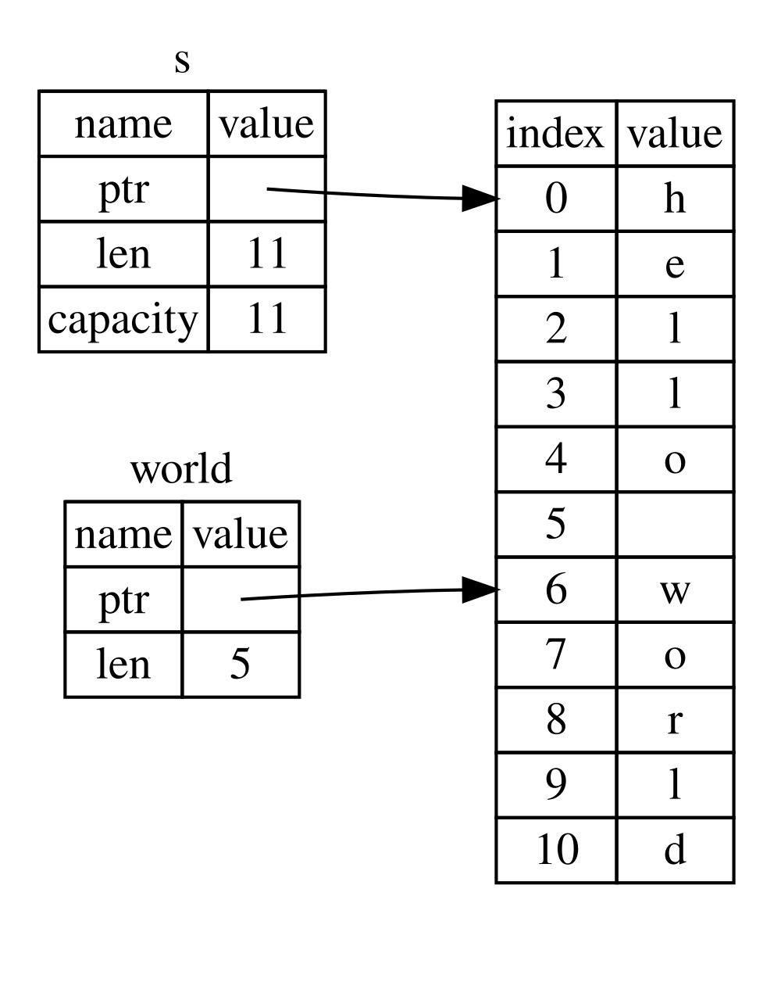

## Le type tranche

Les _tranches_ vous permettent de faire référence à une séquence contiguë d’éléments dans une [collection](ch08-00-common-collections.md)<!-- ignore -->. Une tranche est une sorte de référence : elle n’est donc pas propriétaire des données.

Voici un petit problème de programmation : écrivez une fonction qui prend une chaîne de mots séparés par des espaces et renvoie le premier mot qu’elle trouve dans cette chaîne. Si la fonction ne trouve aucun espace dans la chaîne, celle-ci doit être composée d’un seul mot ; la chaîne entière doit donc être renvoyée.

> Remarque : pour présenter les tranches, nous supposons dans cette section que nous n’utilisons que des caractères ASCII ; le [chapitre 8, section « Stocker du texte encodé en UTF-8 avec des chaînes »][strings]<!-- ignore --> propose une analyse plus approfondie de la gestion de l’UTF-8.

Voyons comment écrire la signature de cette fonction sans utiliser de tranches, afin de comprendre le problème que celles-ci vont résoudre :

```rust,ignore
fn first_word(s: &String) -> ?
```

La fonction `first_word` a un paramètre de type `&String`. Nous n’avons pas besoin de transférer la propriété, donc cela convient. (En Rust idiomatique, les fonctions ne prennent pas possession de leurs arguments à moins d’en avoir besoin ; les raisons de ce choix deviendront plus claires au fil de notre progression.) Mais que devons-nous renvoyer ? Nous n’avons pas vraiment de moyen de désigner *une partie* d’une chaîne. Nous pourrions toutefois renvoyer l’indice de fin du mot, indiqué par un espace. Essayons cette approche, comme le montre le listing 4-7.

<Listing number="4-7" file-name="src/main.rs" caption="La fonction `first_word` qui renvoie un indice d’octet dans le paramètre `String`">

```rust
{{#rustdoc_include ../listings/ch04-understanding-ownership/listing-04-07/src/main.rs:here}}
```

</Listing>

Comme nous devons parcourir la valeur `String` élément par élément et vérifier si une valeur est un espace, nous allons convertir notre `String` en tableau d’octets à l’aide de la méthode `as_bytes`.

```rust,ignore
{{#rustdoc_include ../listings/ch04-understanding-ownership/listing-04-07/src/main.rs:as_bytes}}
```

Ensuite, nous créons un itérateur sur le tableau d’octets à l’aide de la méthode `iter` :

```rust,ignore
{{#rustdoc_include ../listings/ch04-understanding-ownership/listing-04-07/src/main.rs:iter}}
```

Nous aborderons les itérateurs plus en détail au [chapitre 13][ch13]<!-- ignore -->. Pour l’instant, retenez que `iter` est une méthode qui renvoie chaque élément d’une collection et que `enumerate` enveloppe le résultat de `iter` et renvoie chaque élément sous la forme d’un élément de tuple. Le premier élément du tuple renvoyé par `enumerate` est l’indice, et le second est une référence à l’élément. C’est un peu plus pratique que de calculer nous-mêmes l’indice.

Comme la méthode `enumerate` renvoie un tuple, nous pouvons utiliser des motifs pour décomposer ce tuple. Nous parlerons davantage des motifs au [chapitre 6][ch6]<!-- ignore -->. Dans la boucle `for`, nous indiquons un motif qui utilise `i` pour l’indice du tuple et `&item` pour l’octet qu’il contient. Comme `.iter().enumerate()` nous donne une référence à l’élément, nous utilisons `&` dans le motif.

Dans la boucle `for`, nous recherchons l’octet qui représente l’espace à l’aide de la syntaxe des littéraux d’octet. Si nous trouvons un espace, nous renvoyons sa position. Sinon, nous renvoyons la longueur de la chaîne à l’aide de `s.len()`.

```rust,ignore
{{#rustdoc_include ../listings/ch04-understanding-ownership/listing-04-07/src/main.rs:inside_for}}
```

Nous savons maintenant trouver l’indice de fin du premier mot dans la chaîne, mais il y a un problème. Nous renvoyons un `usize` isolé, qui n’a de sens que dans le contexte de `&String`. Autrement dit, comme il s’agit d’une valeur distincte de `String`, rien ne garantit qu’elle sera toujours valide par la suite. Considérons le programme du listing 4-8, qui utilise la fonction `first_word` du listing 4-7.

<Listing number="4-8" file-name="src/main.rs" caption="Stocker le résultat d’un appel à la fonction `first_word`, puis modifier le contenu de la `String`">

```rust
{{#rustdoc_include ../listings/ch04-understanding-ownership/listing-04-08/src/main.rs:here}}
```

</Listing>

Ce programme compile sans erreur et ferait de même si nous utilisions `word` après avoir appelé `s.clear()`. Comme `word` n’est aucunement lié à l’état de `s`, il contient toujours la valeur `5`. Nous pourrions utiliser cette valeur `5` avec la variable `s` pour essayer d’en extraire le premier mot, mais ce serait une erreur, car le contenu de `s` a changé depuis que nous avons enregistré `5` dans `word`.

Devoir s’inquiéter de la désynchronisation de l’indice contenu dans `word` par rapport aux données de `s` est fastidieux et source d’erreurs ! La gestion de ces indices devient encore plus fragile si nous écrivons une fonction `second_word`. Sa signature devrait ressembler à ceci :

```rust,ignore
fn second_word(s: &String) -> (usize, usize) {
```

Nous suivons maintenant un indice de début _et_ un indice de fin, et nous avons encore plus de valeurs calculées à partir des données dans un état donné, mais qui ne sont pas liées à cet état. Nous avons trois variables sans lien entre elles qu’il faut maintenir synchronisées.

Heureusement, Rust a une solution à ce problème : les tranches de chaîne.

### Tranches de chaîne

Une _tranche de chaîne_ est une référence à une séquence contiguë d’éléments d’une `String`. Elle se présente ainsi :

```rust
{{#rustdoc_include ../listings/ch04-understanding-ownership/no-listing-17-slice/src/main.rs:here}}
```

Au lieu de faire référence à l’intégralité de la `String`, `hello` fait référence à une partie de la `String`, indiquée par le segment supplémentaire `[0..5]`. Nous créons des tranches à l’aide d’une plage entre crochets, en indiquant `[indice_de_début..indice_de_fin]`, où _`indice_de_début`_ est la première position de la tranche et _`indice_de_fin`_ est la position qui suit la dernière position de la tranche. En interne, la structure de données d’une tranche stocke la position de début et la longueur de la tranche, qui correspond à _`indice_de_fin`_ moins _`indice_de_début`_. Ainsi, dans le cas de `let world = &s[6..11];`, `world` serait une tranche contenant un pointeur vers l’octet à l’indice 6 de `s` et une valeur de longueur de `5`.

La figure 4-7 l’illustre.



<span class="caption">Figure 4-7 : Une tranche de chaîne faisant référence à une partie d’une `String`</span>

Avec la syntaxe de plage `..` de Rust, si vous voulez commencer à l’indice 0, vous pouvez omettre la valeur qui précède les deux points. Autrement dit, ces expressions sont équivalentes :

```rust
let s = String::from("hello");

let slice = &s[0..2];
let slice = &s[..2];
```

De même, si votre tranche inclut le dernier octet de la `String`, vous pouvez omettre le nombre final. Ces expressions sont donc équivalentes :

```rust
let s = String::from("hello");

let len = s.len();

let slice = &s[3..len];
let slice = &s[3..];
```

Vous pouvez aussi omettre les deux valeurs pour prendre une tranche de la chaîne entière. Ces expressions sont donc équivalentes :

```rust
let s = String::from("hello");

let len = s.len();

let slice = &s[0..len];
let slice = &s[..];
```

> Remarque : les indices des plages de tranches de chaîne doivent correspondre à des limites valides de caractères UTF-8. Si vous tentez de créer une tranche de chaîne au milieu d’un caractère multioctet, votre programme se terminera avec une erreur.

Avec toutes ces informations en tête, réécrivons `first_word` pour qu’elle renvoie une tranche. Le type qui désigne une « tranche de chaîne » s’écrit `&str` :

<Listing file-name="src/main.rs">

```rust
{{#rustdoc_include ../listings/ch04-understanding-ownership/no-listing-18-first-word-slice/src/main.rs:here}}
```

</Listing>

Nous obtenons l’indice de fin du mot comme dans le listing 4-7, en recherchant la première occurrence d’un espace. Lorsque nous trouvons un espace, nous renvoyons une tranche de chaîne en utilisant le début de la chaîne et l’indice de l’espace comme indices de début et de fin.

Désormais, lorsque nous appelons `first_word`, nous obtenons une seule valeur liée aux données sous-jacentes. Cette valeur se compose d’une référence au point de départ de la tranche et du nombre d’éléments qu’elle contient.

Une fonction `second_word` pourrait elle aussi renvoyer une tranche :

```rust,ignore
fn second_word(s: &String) -> &str {
```

Nous avons maintenant une API simple, bien plus difficile à utiliser de manière incorrecte, car le compilateur s’assure que les références dans la `String` restent valides. Vous souvenez-vous de l’erreur dans le programme du listing 4-8, lorsque nous avons obtenu l’indice de fin du premier mot, puis vidé la chaîne, rendant ainsi notre indice invalide ? Ce code était logiquement incorrect, mais ne provoquait aucune erreur immédiate. Les problèmes seraient apparus plus tard si nous avions continué à utiliser l’indice du premier mot avec une chaîne vide. Les tranches rendent cette erreur impossible et nous avertissent beaucoup plus tôt qu’il y a un problème dans notre code. La version de `first_word` qui utilise une tranche déclenchera une erreur de compilation :

<Listing file-name="src/main.rs">

```rust,ignore,does_not_compile
{{#rustdoc_include ../listings/ch04-understanding-ownership/no-listing-19-slice-error/src/main.rs:here}}
```

</Listing>

Voici l’erreur du compilateur :

```console
{{#include ../listings/ch04-understanding-ownership/no-listing-19-slice-error/output.txt}}
```

Rappelez-vous les règles d’emprunt : si nous avons une référence immuable vers quelque chose, nous ne pouvons pas également créer une référence mutable. Comme `clear` doit tronquer la `String`, elle a besoin d’une référence mutable. Le `println!` après l’appel à `clear` utilise la référence contenue dans `word` ; la référence immuable doit donc toujours être active à ce moment-là. Rust interdit que la référence mutable de `clear` et la référence immuable de `word` existent simultanément, et la compilation échoue. Rust a non seulement rendu notre API plus facile à utiliser, mais a aussi éliminé toute une catégorie d’erreurs au moment de la compilation !

<!-- Anciens titres. Ne pas supprimer, car les liens pourraient ne plus fonctionner. -->

<a id="string-literals-are-slices"></a>

#### Les littéraux de chaîne sont des tranches

Rappelez-vous que nous avons dit que les littéraux de chaîne sont stockés dans le binaire. Maintenant que nous connaissons les tranches, nous pouvons comprendre correctement les littéraux de chaîne :

```rust
let s = "Hello, world!";
```

Le type de `s` ici est `&str` : c’est une tranche qui pointe vers un emplacement précis du binaire. C’est aussi la raison pour laquelle les littéraux de chaîne sont immuables : `&str` est une référence immuable.

#### Les tranches de chaîne comme paramètres

Savoir que l’on peut prendre des tranches de littéraux et de valeurs `String` nous amène à une autre amélioration de `first_word`, à savoir sa signature :

```rust,ignore
fn first_word(s: &String) -> &str {
```

Un développeur Rust plus expérimenté écrirait plutôt la signature présentée dans le listing 4-9, car elle nous permet d’utiliser la même fonction avec des valeurs `&String` et des valeurs `&str`.

<Listing number="4-9" caption="Améliorer la fonction `first_word` en utilisant une tranche de chaîne comme type du paramètre `s`">

```rust,ignore
{{#rustdoc_include ../listings/ch04-understanding-ownership/listing-04-09/src/main.rs:here}}
```

</Listing>

Si nous avons une tranche de chaîne, nous pouvons la transmettre directement. Si nous avons une `String`, nous pouvons transmettre une tranche de cette `String` ou une référence vers la `String`. Cette souplesse tire parti des coercitions de déréférencement, une fonctionnalité que nous aborderons au [chapitre 15, section « Utiliser les coercitions de déréférencement dans les fonctions et les méthodes »][deref-coercions]<!-- ignore -->.

Définir une fonction qui prend une tranche de chaîne plutôt qu’une référence vers une `String` rend notre API plus générale et plus utile, sans perte de fonctionnalité :

<Listing file-name="src/main.rs">

```rust
{{#rustdoc_include ../listings/ch04-understanding-ownership/listing-04-09/src/main.rs:usage}}
```

</Listing>

### Autres tranches

Comme on peut s’y attendre, les tranches de chaîne sont propres aux chaînes. Mais il existe aussi un type de tranche plus général. Considérons ce tableau :

```rust
let a = [1, 2, 3, 4, 5];
```

Tout comme nous pouvons vouloir faire référence à une partie d’une chaîne, nous pouvons vouloir faire référence à une partie d’un tableau. Voici comment procéder :

```rust
let a = [1, 2, 3, 4, 5];

let slice = &a[1..3];

assert_eq!(slice, &[2, 3]);
```

Cette tranche a le type `&[i32]`. Elle fonctionne comme les tranches de chaîne : elle stocke une référence au premier élément et une longueur. Vous utiliserez ce type de tranche avec toutes sortes d’autres collections. Nous aborderons ces collections en détail lorsque nous parlerons des vecteurs au chapitre 8.

## Résumé

Les concepts de propriété, d’emprunt et de tranches garantissent la sûreté mémoire des programmes Rust au moment de la compilation. Le langage Rust vous donne le contrôle de l’utilisation de la mémoire, tout comme les autres langages de programmation système. Mais le fait que le propriétaire des données les nettoie automatiquement lorsque sa portée prend fin signifie que vous n’avez pas à écrire et à déboguer du code supplémentaire pour obtenir ce contrôle.

La propriété influe sur de nombreux autres aspects du fonctionnement de Rust ; nous approfondirons donc ces concepts tout au long du reste du livre. Passons au chapitre 5 et voyons comment regrouper des éléments de données dans une `struct`.

[ch13]: ch13-02-iterators.html
[ch6]: ch06-02-match.html#patterns-that-bind-to-values
[strings]: ch08-02-strings.html#storing-utf-8-encoded-text-with-strings
[deref-coercions]: ch15-02-deref.html#using-deref-coercions-in-functions-and-methods