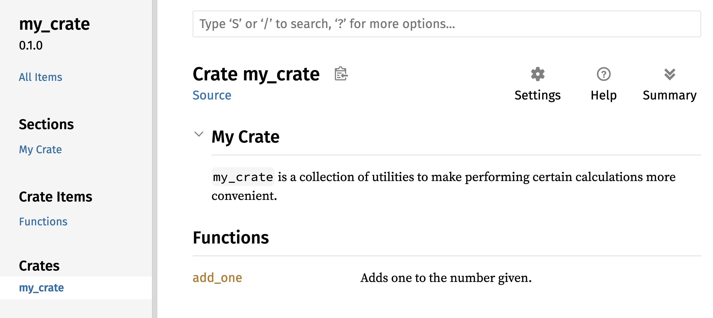

## Publier une caisse sur Crates.io

Nous avons utilisé des paquets de [crates.io](https://crates.io/)<!-- ignore --> comme dépendances de notre projet, mais vous pouvez également partager votre code avec d’autres personnes en publiant vos propres paquets. Le registre de caisses sur [crates.io](https://crates.io/)<!-- ignore --> distribue le code source de vos paquets ; il héberge donc principalement du code open source.

Rust et Cargo disposent de fonctionnalités qui permettent aux utilisateurs de trouver et d’utiliser plus facilement les paquets que vous publiez. Nous allons parler de certaines de ces fonctionnalités, puis expliquer comment publier un paquet.

### Rédiger des commentaires de documentation utiles

Documenter précisément vos paquets aidera les autres utilisateurs à savoir comment et quand les utiliser ; cela vaut donc la peine de consacrer du temps à la rédaction de la documentation. Au chapitre 3, nous avons vu comment commenter du code Rust à l’aide de deux barres obliques, `//`. Rust propose également un type de commentaire particulier destiné à la documentation, appelé de manière appropriée _commentaire de documentation_, qui génère une documentation HTML. Le HTML affiche le contenu des commentaires de documentation associés aux éléments d’API publics, à l’intention des programmeurs qui souhaitent savoir comment _utiliser_ votre caisse, par opposition à la manière dont elle est _implémentée_.

Les commentaires de documentation utilisent trois barres obliques, `///`, au lieu de deux, et prennent en charge la syntaxe Markdown pour mettre le texte en forme. Placez les commentaires de documentation juste avant l’élément qu’ils documentent. La liste 14-1 montre les commentaires de documentation d’une fonction `add_one` dans une caisse nommée `my_crate`.

<Listing number="14-1" file-name="src/lib.rs" caption="Un commentaire de documentation pour une fonction">

```rust,ignore
{{#rustdoc_include ../listings/ch14-more-about-cargo/listing-14-01/src/lib.rs}}
```

</Listing>

Ici, nous décrivons ce que fait la fonction `add_one`, commençons une section intitulée `Examples`, puis fournissons du code qui montre comment utiliser la fonction `add_one`. Nous pouvons générer la documentation HTML à partir de ce commentaire en exécutant `cargo doc`. Cette commande lance l’outil `rustdoc` fourni avec Rust et place la documentation HTML générée dans le répertoire _target/doc_.

Pour plus de commodité, `cargo doc --open` génère le HTML de la documentation de votre caisse actuelle (ainsi que celle de toutes ses dépendances) et ouvre le résultat dans un navigateur Web. Accédez à la fonction `add_one` pour voir comment le texte des commentaires de documentation est rendu, comme le montre la figure 14-1.


<span class="caption">Figure 14-1 : La documentation HTML de la fonction `add_one`</span>

#### Sections couramment utilisées

Nous avons utilisé le titre Markdown `# Examples` dans la liste 14-1 pour créer une section intitulée « Examples » dans le HTML. Voici d’autres sections que les auteurs de caisses utilisent couramment dans leur documentation :

- **Panics** : ces sections décrivent les situations dans lesquelles la fonction documentée pourrait paniquer. Les appelants qui ne veulent pas que leur programme panique doivent veiller à ne pas appeler la fonction dans ces situations.
- **Errors** : si la fonction renvoie un `Result`, il peut être utile aux appelants de décrire les types d’erreurs qui peuvent survenir et les conditions susceptibles de les provoquer, afin qu’ils puissent écrire du code pour gérer les différents types d’erreurs de différentes manières.
- **Safety** : si l’appel de la fonction est `unsafe` (nous parlerons de la sécurité au chapitre 20), une section doit expliquer pourquoi la fonction n’est pas sûre et préciser les invariants que les appelants doivent respecter.

La plupart des commentaires de documentation n’ont pas besoin de toutes ces sections, mais cette liste constitue un bon aide-mémoire des aspects de votre code que les utilisateurs voudront connaître.

#### Les commentaires de documentation comme tests

Ajouter des blocs de code d’exemple à vos commentaires de documentation peut aider à montrer comment utiliser votre bibliothèque et offre un avantage supplémentaire : `cargo test` exécutera également ces exemples de code comme des tests ! Rien ne vaut une documentation accompagnée d’exemples. Mais rien n’est pire que des exemples qui ne fonctionnent plus parce que le code a changé depuis la rédaction de la documentation. Si nous exécutons `cargo test` avec la documentation de la fonction `add_one` de la liste 14-1, nous verrons une section des résultats de test qui ressemble à ceci :

<!-- manual-regeneration
cd listings/ch14-more-about-cargo/listing-14-01/
cargo test
copy just the doc-tests section below
-->

```text
   Doc-tests my_crate

running 1 test
test src/lib.rs - add_one (line 5) ... ok

test result: ok. 1 passed; 0 failed; 0 ignored; 0 measured; 0 filtered out; finished in 0.27s
```

Maintenant, si nous modifions la fonction ou l’exemple de façon à ce que le `assert_eq!` de l’exemple panique, puis que nous exécutons de nouveau `cargo test`, nous verrons que les tests de documentation détectent le décalage entre l’exemple et le code !

<!-- Old headings. Do not remove or links may break. -->

<a id="commenting-contained-items"></a>

#### Commentaires sur les éléments conteneurs

Le style de commentaire de documentation `//!` ajoute de la documentation à l’élément qui *contient* les commentaires, plutôt qu’aux éléments qui les *suivent*. Nous utilisons généralement ces commentaires dans le fichier racine de la caisse (par convention, _src/lib.rs_) ou dans un module, pour documenter la caisse ou le module dans son ensemble.

Par exemple, pour ajouter une documentation décrivant le rôle de la caisse `my_crate`, qui contient la fonction `add_one`, nous ajoutons au début du fichier _src/lib.rs_ des commentaires de documentation commençant par `//!`, comme le montre la liste 14-2.

<Listing number="14-2" file-name="src/lib.rs" caption="La documentation de la caisse `my_crate` dans son ensemble">

```rust,ignore
{{#rustdoc_include ../listings/ch14-more-about-cargo/listing-14-02/src/lib.rs:here}}
```

</Listing>

Notez qu’il n’y a aucun code après la dernière ligne commençant par `//!`. Comme nous avons commencé les commentaires par `//!` plutôt que par `///`, nous documentons l’élément qui contient ce commentaire, au lieu d’un élément qui le suit. Dans ce cas, cet élément est le fichier _src/lib.rs_, qui constitue la racine de la caisse. Ces commentaires décrivent la caisse dans son ensemble.

Lorsque nous exécutons `cargo doc --open`, ces commentaires apparaissent sur la page d’accueil de la documentation de `my_crate`, au-dessus de la liste des éléments publics de la caisse, comme le montre la figure 14-2.

Les commentaires de documentation placés à l’intérieur d’éléments sont particulièrement utiles pour décrire les caisses et les modules. Utilisez-les pour expliquer le rôle général du conteneur et aider vos utilisateurs à comprendre l’organisation de la caisse.



<span class="caption">Figure 14-2 : La documentation générée de `my_crate`, y compris le commentaire décrivant la caisse dans son ensemble</span>

<!-- Old headings. Do not remove or links may break. -->

<a id="exporting-a-convenient-public-api-with-pub-use"></a>

### Exporter une API publique pratique

La structure de votre API publique est un élément essentiel à prendre en compte lors de la publication d’une caisse. Les personnes qui utilisent votre caisse connaissent moins bien sa structure que vous et pourraient avoir du mal à trouver les éléments dont elles ont besoin si votre caisse comporte une hiérarchie de modules importante.

Au chapitre 7, nous avons vu comment rendre des éléments publics à l’aide du mot-clé `pub` et comment importer des éléments dans une portée à l’aide du mot-clé `use`. Cependant, la structure qui vous semble logique pendant le développement d’une caisse n’est pas nécessairement pratique pour ses utilisateurs. Vous pourriez vouloir organiser vos structures dans une hiérarchie à plusieurs niveaux, mais les personnes souhaitant utiliser un type défini profondément dans cette hiérarchie pourraient avoir du mal à découvrir son existence. Elles pourraient aussi être contrariées de devoir écrire `use my_crate::some_module::another_module::UsefulType;` plutôt que `use my_crate::UsefulType;`.

Heureusement, si la structure n’est *pas* pratique à utiliser depuis une autre bibliothèque, vous n’avez pas besoin de réorganiser votre organisation interne : vous pouvez plutôt réexporter des éléments afin de créer une structure publique différente de votre structure privée, en utilisant `pub use`. La *réexportation* consiste à prendre un élément public situé à un endroit et à le rendre public à un autre endroit, comme s’il y était défini.

Par exemple, imaginons que nous créions une bibliothèque nommée `art` pour modéliser des concepts artistiques. Cette bibliothèque contient deux modules : un module `kinds` qui contient deux énumérations nommées `PrimaryColor` et `SecondaryColor`, et un module `utils` qui contient une fonction nommée `mix`, comme le montre la liste 14-3.

<Listing number="14-3" file-name="src/lib.rs" caption="Une bibliothèque `art` dont les éléments sont organisés dans les modules `kinds` et `utils`">

```rust,noplayground,test_harness
{{#rustdoc_include ../listings/ch14-more-about-cargo/listing-14-03/src/lib.rs:here}}
```

</Listing>

La figure 14-3 montre à quoi ressemblerait la page d’accueil de la documentation de cette caisse, générée par `cargo doc`.


<span class="caption">Figure 14-3 : La page d’accueil de la documentation de `art`, qui répertorie les modules `kinds` et `utils`</span>

Notez que les types `PrimaryColor` et `SecondaryColor` ne sont pas répertoriés sur la page d’accueil, pas plus que la fonction `mix`. Nous devons cliquer sur `kinds` et `utils` pour les voir.

Une autre caisse qui dépend de cette bibliothèque devrait importer les éléments de `art` dans une portée au moyen d’instructions `use`, en précisant la structure des modules actuellement définie. La liste 14-4 montre un exemple de caisse qui utilise les éléments `PrimaryColor` et `mix` de la caisse `art`.

<Listing number="14-4" file-name="src/main.rs" caption="Une caisse qui utilise les éléments de `art` en exposant sa structure interne">

```rust,ignore
{{#rustdoc_include ../listings/ch14-more-about-cargo/listing-14-04/src/main.rs}}
```

</Listing>

L’auteur du code de la liste 14-4, qui utilise la caisse `art`, a dû découvrir que `PrimaryColor` se trouve dans le module `kinds` et que `mix` se trouve dans le module `utils`. La structure des modules de la caisse `art` est plus pertinente pour les développeurs qui travaillent sur cette caisse que pour ceux qui l’utilisent. La structure interne ne fournit aucune information utile à quelqu’un qui cherche à comprendre comment utiliser la caisse `art` ; elle ne fait que semer la confusion, car les développeurs qui l’utilisent doivent chercher où se trouvent les éléments et préciser les noms des modules dans leurs instructions `use`.

Pour supprimer l’organisation interne de l’API publique, nous pouvons modifier le code de la caisse `art` de la liste 14-3 en ajoutant des instructions `pub use` qui réexportent les éléments au niveau supérieur, comme le montre la liste 14-5.

<Listing number="14-5" file-name="src/lib.rs" caption="Ajouter des instructions `pub use` pour réexporter des éléments">

```rust,ignore
{{#rustdoc_include ../listings/ch14-more-about-cargo/listing-14-05/src/lib.rs:here}}
```

</Listing>

La documentation de l’API générée par `cargo doc` pour cette caisse répertoriera désormais les réexportations sur la page d’accueil et contiendra des liens vers celles-ci, comme le montre la figure 14-4. Les types `PrimaryColor` et `SecondaryColor`, ainsi que la fonction `mix`, seront ainsi plus faciles à trouver.


<span class="caption">Figure 14-4 : La page d’accueil de la documentation de `art`, qui répertorie les réexportations</span>

Les utilisateurs de la caisse `art` peuvent toujours voir et utiliser la structure interne de la liste 14-3, comme le montre la liste 14-4, ou choisir la structure plus pratique de la liste 14-5, comme le montre la liste 14-6.

<Listing number="14-6" file-name="src/main.rs" caption="Un programme qui utilise les éléments réexportés de la caisse `art`">

```rust,ignore
{{#rustdoc_include ../listings/ch14-more-about-cargo/listing-14-06/src/main.rs:here}}
```

</Listing>

Lorsqu’il existe de nombreux modules imbriqués, réexporter les types au niveau supérieur avec `pub use` peut considérablement améliorer l’expérience des utilisateurs de la caisse. Une autre utilisation courante de `pub use` consiste à réexporter dans la caisse actuelle les définitions d’une dépendance, afin d’intégrer ces définitions à l’API publique de votre caisse.

Créer une API publique bien conçue relève davantage de l’art que de la science, et vous pouvez procéder par itérations pour trouver celle qui convient le mieux à vos utilisateurs. Choisir `pub use` vous permet d’organiser votre caisse en interne avec souplesse et de dissocier cette organisation interne de ce que vous présentez à vos utilisateurs. Examinez le code de certaines caisses que vous avez installées pour voir si leur structure interne diffère de leur API publique.

### Créer un compte Crates.io

Avant de pouvoir publier des caisses, vous devez créer un compte sur [crates.io](https://crates.io/)<!-- ignore --> et obtenir un jeton d’API. Pour cela, rendez-vous sur la page d’accueil de [crates.io](https://crates.io/)<!-- ignore --> et connectez-vous avec un compte GitHub. (Un compte GitHub est actuellement requis, mais le site pourrait proposer d’autres moyens de créer un compte à l’avenir.) Une fois connecté, accédez aux paramètres de votre compte à l’adresse [https://crates.io/me/](https://crates.io/me/)<!-- ignore --> et récupérez votre clé d’API. Exécutez ensuite la commande `cargo login` et collez votre clé d’API lorsque vous y êtes invité, comme ceci :

```console
$ cargo login
abcdefghijklmnopqrstuvwxyz012345
```

Cette commande informe Cargo de votre jeton d’API et l’enregistre localement dans _~/.cargo/credentials.toml_. Notez que ce jeton est secret : ne le partagez avec personne. Si vous le partagez avec quelqu’un, quelle qu’en soit la raison, vous devez le révoquer et en générer un nouveau sur [crates.io](https://crates.io/)<!-- ignore
-->.

### Ajouter des métadonnées à une nouvelle caisse

Imaginons que vous ayez une caisse à publier. Avant de la publier, vous devez ajouter des métadonnées dans la section `[package]` du fichier _Cargo.toml_ de la caisse.

Votre caisse doit avoir un nom unique. Tant que vous travaillez localement sur une caisse, vous pouvez lui donner le nom de votre choix. Toutefois, les noms de caisses sur [crates.io](https://crates.io/)<!-- ignore --> sont attribués selon le principe du premier arrivé, premier servi. Une fois qu’un nom de caisse est pris, personne d’autre ne peut publier une caisse sous ce nom. Avant d’essayer de publier une caisse, recherchez le nom que vous souhaitez utiliser. S’il est déjà utilisé, vous devrez en trouver un autre et modifier le champ `name` de la section `[package]` du fichier _Cargo.toml_ pour utiliser ce nouveau nom lors de la publication, comme ceci :

<span class="filename">Nom du fichier : Cargo.toml</span>

```toml
[package]
name = "guessing_game"
```

Même si vous avez choisi un nom unique, si vous exécutez `cargo publish` pour publier la caisse à ce stade, vous recevrez un avertissement, puis une erreur :

<!-- manual-regeneration
Create a new package with an unregistered name, making no further modifications
  to the generated package, so it is missing the description and license fields.
cargo publish
copy just the relevant lines below
-->

```console
$ cargo publish
    Updating crates.io index
warning: manifest has no description, license, license-file, documentation, homepage or repository.
See https://doc.rust-lang.org/cargo/reference/manifest.html#package-metadata for more info.
--snip--
error: failed to publish to registry at https://crates.io

Caused by:
  the remote server responded with an error (status 400 Bad Request): missing or empty metadata fields: description, license. Please see https://doc.rust-lang.org/cargo/reference/manifest.html for more information on configuring these fields
```

Cette erreur est due à l’absence d’informations essentielles : une description et une licence sont nécessaires pour que les utilisateurs sachent ce que fait votre caisse et sous quelles conditions ils peuvent l’utiliser. Dans _Cargo.toml_, ajoutez une description d’une ou deux phrases, car elle apparaîtra à côté de votre caisse dans les résultats de recherche. Pour le champ `license`, vous devez fournir une _valeur d’identifiant de licence_. La [Software Package Data Exchange (SPDX) de la Linux Foundation][spdx] répertorie les identifiants que vous pouvez utiliser. Par exemple, pour indiquer que votre caisse est sous licence MIT, ajoutez l’identifiant `MIT` :

<span class="filename">Nom du fichier : Cargo.toml</span>

```toml
[package]
name = "guessing_game"
license = "MIT"
```

Si vous souhaitez utiliser une licence qui ne figure pas dans le répertoire SPDX, vous devez placer le texte de cette licence dans un fichier, inclure ce fichier dans votre projet, puis utiliser `license-file` pour indiquer le nom de ce fichier au lieu d’utiliser la clé `license`.

Les conseils relatifs au choix de la licence appropriée pour votre projet dépassent le cadre de ce livre. Beaucoup de membres de la communauté Rust accordent à leurs projets une double licence, comme Rust, en utilisant `MIT OR Apache-2.0`. Cela montre que vous pouvez également spécifier plusieurs identifiants de licence séparés par `OR` pour attribuer plusieurs licences à votre projet.

Une fois que vous avez choisi un nom unique et ajouté la version, la description et la licence, le fichier _Cargo.toml_ d’un projet prêt à être publié peut ressembler à ceci :

<span class="filename">Nom du fichier : Cargo.toml</span>

```toml
[package]
name = "guessing_game"
version = "0.1.0"
edition = "2024"
description = "A fun game where you guess what number the computer has chosen."
license = "MIT OR Apache-2.0"

[dependencies]
```

La [documentation de Cargo](https://doc.rust-lang.org/cargo/) décrit d’autres métadonnées que vous pouvez spécifier pour aider les utilisateurs à découvrir et à utiliser plus facilement votre caisse.

### Publier sur Crates.io

Maintenant que vous avez créé un compte, enregistré votre jeton d’API, choisi un nom pour votre caisse et indiqué les métadonnées requises, vous êtes prêt à la publier ! La publication d’une caisse téléverse une version précise sur [crates.io](https://crates.io/)<!-- ignore --> afin que d’autres personnes puissent l’utiliser.

Soyez prudent, car une publication est _définitive_. La version ne peut jamais être remplacée, et le code ne peut pas être supprimé, sauf dans certaines circonstances. L’un des principaux objectifs de Crates.io est de servir d’archive permanente du code, afin que les compilations de tous les projets dépendant de caisses de [crates.io](https://crates.io/)<!-- ignore --> continuent de fonctionner. Autoriser la suppression de versions rendrait cet objectif impossible à atteindre. Cependant, vous pouvez publier un nombre illimité de versions d’une caisse.

Exécutez de nouveau la commande `cargo publish`. Cette fois, elle devrait réussir :

<!-- manual-regeneration
go to some valid crate, publish a new version
cargo publish
copy just the relevant lines below
-->

```console
$ cargo publish
    Updating crates.io index
   Packaging guessing_game v0.1.0 (file:///projects/guessing_game)
    Packaged 6 files, 1.2KiB (895.0B compressed)
   Verifying guessing_game v0.1.0 (file:///projects/guessing_game)
   Compiling guessing_game v0.1.0
(file:///projects/guessing_game/target/package/guessing_game-0.1.0)
    Finished `dev` profile [unoptimized + debuginfo] target(s) in 0.19s
   Uploading guessing_game v0.1.0 (file:///projects/guessing_game)
    Uploaded guessing_game v0.1.0 to registry `crates-io`
note: waiting for `guessing_game v0.1.0` to be available at registry
`crates-io`.
You may press ctrl-c to skip waiting; the crate should be available shortly.
   Published guessing_game v0.1.0 at registry `crates-io`
```

Félicitations ! Vous avez partagé votre code avec la communauté Rust, et n’importe qui peut désormais facilement ajouter votre caisse comme dépendance à son projet.

### Publier une nouvelle version d’une caisse existante

Lorsque vous avez apporté des modifications à votre caisse et que vous êtes prêt à publier une nouvelle version, modifiez la valeur `version` indiquée dans votre fichier _Cargo.toml_, puis publiez de nouveau. Utilisez les règles de [gestion sémantique des versions][semver] pour choisir le prochain numéro de version approprié, selon la nature des modifications apportées. Exécutez ensuite `cargo publish` pour téléverser la nouvelle version.

<!-- Old headings. Do not remove or links may break. -->

<a id="removing-versions-from-cratesio-with-cargo-yank"></a>
<a id="deprecating-versions-from-cratesio-with-cargo-yank"></a>

### Déprécier des versions sur Crates.io

Même si vous ne pouvez pas supprimer les versions précédentes d’une caisse, vous pouvez empêcher de futurs projets de les ajouter comme nouvelles dépendances. Cela peut être utile lorsqu’une version d’une caisse est défectueuse pour une raison ou une autre. Dans ce genre de situation, Cargo permet de retirer une version de la disponibilité.

_Retirer_ une version empêche les nouveaux projets d’en dépendre, tout en permettant aux projets existants qui en dépendent de continuer à fonctionner. En pratique, cela signifie que les projets disposant d’un fichier _Cargo.lock_ ne seront pas affectés, et que les futurs fichiers _Cargo.lock_ générés n’utiliseront pas la version retirée.

Pour retirer une version d’une caisse, placez-vous dans le répertoire de la caisse que vous avez publiée précédemment, exécutez `cargo yank` et indiquez la version à retirer. Par exemple, si nous avons publié une caisse nommée `guessing_game` en version 1.0.1 et que nous voulons la retirer, nous exécutons la commande suivante dans le répertoire du projet `guessing_game` :

<!-- manual-regeneration:
cargo yank carol-test --version 2.1.0
cargo yank carol-test --version 2.1.0 --undo
-->

```console
$ cargo yank --vers 1.0.1
    Updating crates.io index
        Yank guessing_game@1.0.1
```

En ajoutant `--undo` à la commande, vous pouvez également annuler le retrait et permettre de nouveau aux projets de dépendre de cette version :

```console
$ cargo yank --vers 1.0.1 --undo
    Updating crates.io index
      Unyank guessing_game@1.0.1
```

Le retrait d’une version ne supprime _pas_ le code. Il ne peut pas, par exemple, supprimer des secrets téléversés par erreur. Si cela se produit, vous devez immédiatement réinitialiser ces secrets.

[spdx]: https://spdx.org/licenses/
[semver]: https://semver.org/