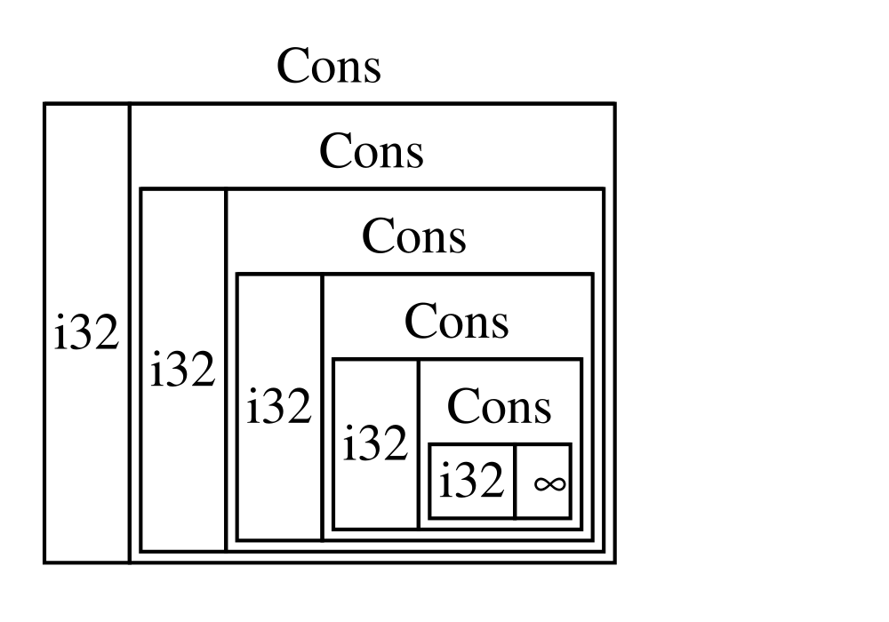
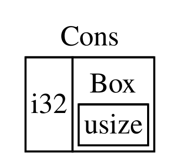

## Utiliser `Box<T>` pour pointer vers des données sur le tas

Le pointeur intelligent le plus simple est une boîte, dont le type s’écrit
`Box<T>`. Les _boîtes_ permettent de stocker des données sur le tas plutôt que sur
la pile. Il ne reste sur la pile que le pointeur vers les données du tas.
Reportez-vous au chapitre 4 pour revoir la différence entre la pile et le tas.

Les boîtes n’entraînent aucun surcoût de performance, hormis le fait de stocker
leurs données sur le tas plutôt que sur la pile. Mais elles n’offrent pas non
plus beaucoup de fonctionnalités supplémentaires. Vous les utiliserez le plus
souvent dans les situations suivantes :

- Lorsque vous avez un type dont la taille ne peut pas être connue à la compilation et que vous souhaitez utiliser une valeur de ce type dans un contexte qui exige une taille exacte
- Lorsque vous avez une grande quantité de données et que vous souhaitez transférer leur propriété tout en vous assurant qu’elles ne seront pas copiées lors du transfert
- Lorsque vous souhaitez posséder une valeur et que vous tenez uniquement à ce qu’elle soit d’un type qui implémente un trait particulier, plutôt que d’un type spécifique

Nous allons présenter la première situation dans [« Activer les types
récursifs avec des boîtes »](#enabling-recursive-types-with-boxes)<!-- ignore -->. Dans le deuxième cas,
le transfert de propriété d’une grande quantité de données peut prendre
beaucoup de temps, car les données sont copiées sur la pile. Pour améliorer les
performances dans cette situation, nous pouvons stocker la grande quantité de
données sur le tas dans une boîte. Ainsi, seule la petite quantité de données
du pointeur est copiée sur la pile, tandis que les données vers lesquelles il
pointe restent au même endroit sur le tas. Le troisième cas est appelé un
_objet de trait_, et le chapitre 18 est consacré à ce sujet dans [« Utiliser
les objets de trait pour abstraire les comportements
partagés »][trait-objects]<!-- ignore -->. Vous pourrez donc réutiliser ce que vous apprenez ici dans cette section !

<!-- Old headings. Do not remove or links may break. -->

<a id="using-boxt-to-store-data-on-the-heap"></a>

### Stocker des données sur le tas

Avant d’aborder le cas d’utilisation de `Box<T>` pour stocker des données sur
le tas, nous allons présenter la syntaxe et la façon d’interagir avec les
valeurs stockées dans un `Box<T>`.

La liste 15-1 montre comment utiliser une boîte pour stocker une valeur `i32`
sur le tas.

<Listing number="15-1" file-name="src/main.rs" caption="Stocker une valeur `i32` sur le tas à l’aide d’une boîte">

```rust
{{#rustdoc_include ../listings/ch15-smart-pointers/listing-15-01/src/main.rs}}
```

</Listing>

Nous définissons la variable `b` avec la valeur d’un `Box` qui pointe vers la
valeur `5`, allouée sur le tas. Ce programme affichera `b = 5` ; dans ce cas,
nous pouvons accéder aux données de la boîte de la même manière que si elles se
trouvaient sur la pile. Comme toute valeur possédée, une boîte est désallouée
lorsqu’elle sort de portée, comme c’est le cas de `b` à la fin de `main`. La
désallocation concerne à la fois la boîte (stockée sur la pile) et les données
vers lesquelles elle pointe (stockées sur le tas).

Stocker une seule valeur sur le tas n’est pas très utile ; vous n’utiliserez
donc pas souvent les boîtes seules de cette manière. Dans la plupart des
situations, il est plus approprié de stocker des valeurs comme un simple `i32`
sur la pile, où elles sont placées par défaut. Voyons un cas où les boîtes nous
permettent de définir des types que nous ne pourrions pas définir sans elles.

### Activer les types récursifs avec des boîtes

Une valeur d’un _type récursif_ peut contenir une autre valeur du même type.
Les types récursifs posent problème, car Rust doit connaître à la compilation
l’espace occupé par un type. Cependant, l’imbrication de valeurs de types
récursifs pourrait théoriquement se poursuivre à l’infini ; Rust ne peut donc
pas déterminer l’espace nécessaire à la valeur. Comme les boîtes ont une taille
connue, nous pouvons rendre possibles les types récursifs en insérant une boîte
dans la définition du type récursif.

À titre d’exemple de type récursif, explorons la liste cons. Il s’agit d’un type
de données couramment utilisé dans les langages de programmation fonctionnelle.
Le type de liste cons que nous allons définir est simple, à l’exception de la
récursivité ; les concepts présentés dans cet exemple seront donc utiles chaque
fois que vous rencontrerez des situations plus complexes impliquant des types
récursifs.

<!-- Old headings. Do not remove or links may break. -->

<a id="more-information-about-the-cons-list"></a>

#### Comprendre la liste cons

Une _liste cons_ est une structure de données issue du langage de programmation
Lisp et de ses dialectes. Composée de paires imbriquées, elle constitue la
version Lisp d’une liste chaînée. Son nom vient de la fonction `cons` (abréviation
de _fonction de construction_) de Lisp, qui construit une nouvelle paire à
partir de ses deux arguments. En appelant `cons` sur une paire composée d’une
valeur et d’une autre paire, nous pouvons construire des listes cons formées de
paires récursives.

Par exemple, voici une représentation en pseudocode d’une liste cons contenant
la liste `1, 2, 3`, chaque paire étant entre parenthèses :

```text
(1, (2, (3, Nil)))
```

Chaque élément d’une liste cons contient deux éléments : la valeur de l’élément
courant et celle de l’élément suivant. Le dernier élément de la liste ne
contient qu’une valeur appelée `Nil`, sans élément suivant. Une liste cons est
produite en appelant récursivement la fonction `cons`. Le nom conventionnel
utilisé pour désigner le cas de base de la récursion est `Nil`. Notez qu’il ne
s’agit pas du même concept que « null » ou « nil », abordé au chapitre 6, qui
désigne une valeur invalide ou absente.

La liste cons n’est pas une structure de données couramment utilisée en Rust.
La plupart du temps, lorsque vous avez une liste d’éléments en Rust, il est
préférable d’utiliser `Vec<T>`. D’autres types de données récursifs plus
complexes _sont_ utiles dans diverses situations, mais commencer par la liste
cons dans ce chapitre nous permet d’explorer comment les boîtes nous aident à
définir un type de données récursif sans trop de distractions.

La liste 15-2 contient une définition d’énumération pour une liste cons. Notez
que ce code ne peut pas encore être compilé, car la taille du type `List` n’est
pas connue, comme nous allons le montrer.

<Listing number="15-2" file-name="src/main.rs" caption="Première tentative de définition d’une énumération représentant une structure de données de liste cons contenant des valeurs `i32`">

```rust,ignore,does_not_compile
{{#rustdoc_include ../listings/ch15-smart-pointers/listing-15-02/src/main.rs:here}}
```

</Listing>

> Remarque : pour les besoins de cet exemple, nous implémentons une liste cons
> qui ne contient que des valeurs `i32`. Nous aurions pu utiliser des types
> génériques, comme nous l’avons vu au chapitre 10, afin de définir un type de
> liste cons pouvant stocker des valeurs de n’importe quel type.

Pour utiliser le type `List` afin de stocker la liste `1, 2, 3`, nous écririons
le code de la liste 15-3.

<Listing number="15-3" file-name="src/main.rs" caption="Utilisation de l’énumération `List` pour stocker la liste `1, 2, 3`">

```rust,ignore,does_not_compile
{{#rustdoc_include ../listings/ch15-smart-pointers/listing-15-03/src/main.rs:here}}
```

</Listing>

La première valeur `Cons` contient `1` et une autre valeur `List`. Cette valeur
`List` est une autre valeur `Cons`, qui contient `2` et une autre valeur
`List`. Cette valeur `List` est encore une autre valeur `Cons`, qui contient
`3` et une valeur `List`, qui est finalement `Nil`, la variante non récursive
qui marque la fin de la liste.

Si nous essayons de compiler le code de la liste 15-3, nous obtenons l’erreur
présentée dans la liste 15-4.

<Listing number="15-4" caption="Erreur obtenue lors d’une tentative de définition d’une énumération récursive">

```console
{{#include ../listings/ch15-smart-pointers/listing-15-03/output.txt}}
```

</Listing>

L’erreur indique que ce type « a une taille infinie ». Cela s’explique par le
fait que nous avons défini `List` avec une variante récursive : elle contient
directement une autre valeur de son propre type. Par conséquent, Rust ne peut
pas déterminer l’espace nécessaire pour stocker une valeur `List`. Voyons en
détail pourquoi nous obtenons cette erreur. Nous allons d’abord examiner
comment Rust détermine l’espace nécessaire pour stocker une valeur d’un type
non récursif.

#### Calculer la taille d’un type non récursif

Rappelez-vous l’énumération `Message` que nous avons définie dans la liste 6-2,
lorsque nous avons abordé les définitions d’énumérations au chapitre 6 :

```rust
{{#rustdoc_include ../listings/ch06-enums-and-pattern-matching/listing-06-02/src/main.rs:here}}
```

Pour déterminer l’espace à allouer à une valeur `Message`, Rust examine chaque
variante afin de trouver celle qui nécessite le plus d’espace. Rust constate
que `Message::Quit` ne nécessite aucun espace, que `Message::Move` a besoin
d’assez d’espace pour stocker deux valeurs `i32`, et ainsi de suite. Comme une
seule variante sera utilisée, l’espace maximal dont une valeur `Message` aura
besoin correspond à celui nécessaire pour stocker la plus grande de ses
variantes.

Comparons cela à ce qui se passe lorsque Rust tente de déterminer l’espace
nécessaire à un type récursif comme l’énumération `List` de la liste 15-2. Le
compilateur commence par examiner la variante `Cons`, qui contient une valeur
de type `i32` et une valeur de type `List`. La variante `Cons` a donc besoin
d’un espace égal à la taille d’un `i32` plus celle d’un `List`. Pour déterminer
l’espace nécessaire au type `List`, le compilateur examine ses variantes, en
commençant par la variante `Cons`. Cette dernière contient une valeur de type
`i32` et une valeur de type `List`, et le processus se poursuit à l’infini,
comme le montre la figure 15-1.



<span class="caption">Figure 15-1 : Une `List` infinie composée d’un nombre infini de
variantes `Cons`</span>

<!-- Old headings. Do not remove or links may break. -->

<a id="using-boxt-to-get-a-recursive-type-with-a-known-size"></a>

#### Obtenir un type récursif de taille connue

Comme Rust ne peut pas déterminer l’espace à allouer aux types définis de
manière récursive, le compilateur affiche une erreur accompagnée de cette
suggestion utile :

<!-- manual-regeneration
after doing automatic regeneration, look at listings/ch15-smart-pointers/listing-15-03/output.txt and copy the relevant line
-->

```text
help: insert some indirection (e.g., a `Box`, `Rc`, or `&`) to break the cycle
  |
2 |     Cons(i32, Box<List>),
  |               ++++    +
```

Dans cette suggestion, _indirection_ signifie qu’au lieu de stocker une valeur
directement, nous devrions modifier la structure de données pour stocker la
valeur indirectement, en stockant un pointeur vers celle-ci.

Comme un `Box<T>` est un pointeur, Rust connaît toujours l’espace nécessaire à
un `Box<T>` : la taille d’un pointeur ne dépend pas de la quantité de données
vers lesquelles il pointe. Cela signifie que nous pouvons placer un `Box<T>`
dans la variante `Cons` à la place d’une autre valeur `List` directe. Le
`Box<T>` pointera vers la valeur `List` suivante, qui se trouvera sur le tas et
non dans la variante `Cons`. Conceptuellement, nous avons toujours une liste,
créée à partir de listes contenant d’autres listes, mais cette implémentation
ressemble davantage à des éléments placés les uns à côté des autres qu’à des
éléments imbriqués les uns dans les autres.

Nous pouvons modifier la définition de l’énumération `List` de la liste 15-2
et l’utilisation de `List` de la liste 15-3 pour obtenir le code de la liste
15-5, qui pourra être compilé.

<Listing number="15-5" file-name="src/main.rs" caption="Définition de `List` utilisant `Box<T>` afin d’avoir une taille connue">

```rust
{{#rustdoc_include ../listings/ch15-smart-pointers/listing-15-05/src/main.rs}}
```

</Listing>

La variante `Cons` a besoin de l’espace nécessaire à un `i32`, plus celui
nécessaire pour stocker les données du pointeur de la boîte. La variante `Nil`
ne stocke aucune valeur ; elle nécessite donc moins d’espace sur la pile que la
variante `Cons`. Nous savons désormais que toute valeur `List` occupera
l’espace nécessaire à un `i32`, plus celui nécessaire aux données du pointeur
d’une boîte. En utilisant une boîte, nous avons interrompu la chaîne récursive
infinie, ce qui permet au compilateur de déterminer l’espace nécessaire pour
stocker une valeur `List`. La figure 15-2 montre à quoi ressemble maintenant
la variante `Cons`.



<span class="caption">Figure 15-2 : Une `List` dont la taille n’est pas infinie,
car `Cons` contient une `Box`</span>

Les boîtes ne fournissent que l’indirection et l’allocation sur le tas ; elles
n’ont pas d’autres fonctionnalités spéciales, comme celles que nous verrons
avec les autres types de pointeurs intelligents. Elles n’entraînent pas non
plus le surcoût de performance associé à ces fonctionnalités spéciales ; elles
peuvent donc être utiles dans des cas comme celui de la liste cons, où
l’indirection est la seule fonctionnalité dont nous avons besoin. Nous
examinerons d’autres cas d’utilisation des boîtes au chapitre 18.

Le type `Box<T>` est un pointeur intelligent, car il implémente le trait
`Deref`, qui permet de traiter les valeurs `Box<T>` comme des références.
Lorsqu’une valeur `Box<T>` sort de portée, les données du tas vers lesquelles
la boîte pointe sont également nettoyées, grâce à l’implémentation du trait
`Drop`. Ces deux traits joueront un rôle encore plus important dans les
fonctionnalités fournies par les autres types de pointeurs intelligents dont
nous parlerons dans la suite de ce chapitre. Examinons ces deux traits plus en
détail.

[trait-objects]: ch18-02-trait-objects.html#using-trait-objects-to-abstract-over-shared-behavior