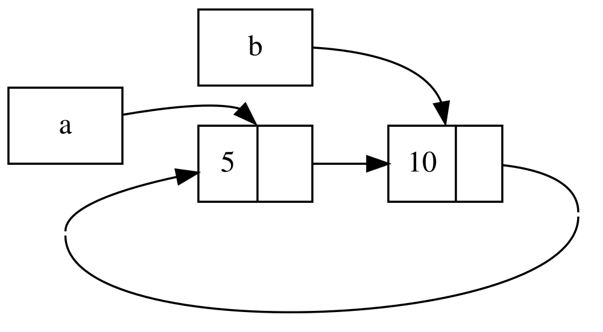

## Les cycles de références peuvent entraîner des fuites mémoire

Les garanties de sécurité mémoire de Rust rendent difficile, mais pas impossible,
la création accidentelle de mémoire qui n’est jamais libérée (ce qu’on appelle
une _fuite mémoire_). Rust ne garantit pas que les fuites mémoire soient
entièrement évitées : elles sont donc compatibles avec la sécurité mémoire en
Rust. Nous pouvons voir que Rust autorise les fuites mémoire en utilisant
`Rc<T>` et `RefCell<T>` : il est possible de créer des références où des
éléments se référencent mutuellement en boucle. Cela entraîne des fuites
mémoire, car le compteur de références de chaque élément du cycle n’atteindra
jamais 0 et les valeurs ne seront jamais supprimées.

### Créer un cycle de références

Voyons comment un cycle de références peut se produire et comment l’éviter, en
commençant par la définition de l’énumération `List` et une méthode `tail` dans
la Listing 15-25.

<Listing number="15-25" file-name="src/main.rs" caption="Définition d’une liste cons qui contient un `RefCell<T>` afin que nous puissions modifier ce vers quoi pointe une variante `Cons`">

```rust
{{#rustdoc_include ../listings/ch15-smart-pointers/listing-15-25/src/main.rs:here}}
```

</Listing>

Nous utilisons une autre variante de la définition de `List` de la Listing 15-5.
Le deuxième élément de la variante `Cons` est maintenant `RefCell<Rc<List>>`,
ce qui signifie qu’au lieu de pouvoir modifier la valeur `i32`, comme dans la
Listing 15-24, nous voulons modifier la valeur `List` vers laquelle pointe une
variante `Cons`. Nous ajoutons également une méthode `tail` pour accéder
facilement au deuxième élément si nous avons une variante `Cons`.

Dans la Listing 15-26, nous ajoutons une fonction `main` qui utilise les
définitions de la Listing 15-25. Ce code crée une liste dans `a` et une liste
dans `b` qui pointe vers la liste dans `a`. Ensuite, il modifie la liste dans
`a` pour qu’elle pointe vers `b`, créant ainsi un cycle de références. Des
instructions `println!` sont présentes tout au long du code pour montrer les
compteurs de références à différents moments du processus.

<Listing number="15-26" file-name="src/main.rs" caption="Création d’un cycle de références entre deux valeurs `List` qui pointent l’une vers l’autre">

```rust
{{#rustdoc_include ../listings/ch15-smart-pointers/listing-15-26/src/main.rs:here}}
```

</Listing>

Nous créons une instance `Rc<List>` contenant une valeur `List` dans la
variable `a`, avec une liste initiale `5, Nil`. Nous créons ensuite une autre
instance `Rc<List>` contenant une autre valeur `List` dans la variable `b`,
qui contient la valeur `10` et pointe vers la liste dans `a`.

Nous modifions `a` pour qu’il pointe vers `b` au lieu de `Nil`, créant ainsi
un cycle. Pour cela, nous utilisons la méthode `tail` afin d’obtenir une
référence au `RefCell<Rc<List>>` dans `a`, que nous plaçons dans la variable
`link`. Ensuite, nous utilisons la méthode `borrow_mut` sur le
`RefCell<Rc<List>>` pour remplacer la valeur qu’il contient : au lieu d’un
`Rc<List>` contenant une valeur `Nil`, nous y plaçons le `Rc<List>` de `b`.

Lorsque nous exécutons ce code en laissant pour le moment la dernière
instruction `println!` en commentaire, nous obtenons cette sortie :

```console
{{#include ../listings/ch15-smart-pointers/listing-15-26/output.txt}}
```

Après avoir modifié la liste dans `a` pour qu’elle pointe vers `b`, le compteur
de références des instances `Rc<List>` de `a` et de `b` est égal à 2. À la fin
de `main`, Rust supprime la variable `b`, ce qui fait passer le compteur de
références de l’instance `Rc<List>` de `b` de 2 à 1. La mémoire de `Rc<List>`
allouée sur le tas n’est alors pas supprimée, car son compteur de références
est égal à 1, et non à 0. Ensuite, Rust supprime `a`, ce qui fait également
passer le compteur de références de l’instance `Rc<List>` de `a` de 2 à 1. La
mémoire de cette instance ne peut pas non plus être supprimée, car l’autre
instance `Rc<List>` y fait toujours référence. La mémoire allouée à la liste ne
sera jamais libérée. Pour visualiser ce cycle de références, nous avons créé le
schéma de la Figure 15-4.



<span class="caption">Figure 15-4 : Un cycle de références entre les listes `a` et `b`, qui pointent l’une vers l’autre</span>

Si vous décommentez la dernière instruction `println!` et exécutez le programme,
Rust tentera d’afficher ce cycle, où `a` pointe vers `b`, qui pointe vers `a`,
et ainsi de suite, jusqu’à ce que la pile déborde.

Comparées à celles d’un programme réel, les conséquences de la création d’un
cycle de références dans cet exemple ne sont pas très graves : le programme se
termine juste après la création du cycle. Cependant, si un programme plus
complexe allouait beaucoup de mémoire dans un cycle et la conservait longtemps,
il utiliserait plus de mémoire que nécessaire et pourrait surcharger le
système, jusqu’à épuiser la mémoire disponible.

Il n’est pas facile de créer des cycles de références, mais ce n’est pas
impossible non plus. Si vous avez des valeurs `RefCell<T>` qui contiennent des
valeurs `Rc<T>`, ou d’autres combinaisons imbriquées de types combinant
mutabilité intérieure et comptage des références, vous devez veiller à ne pas
créer de cycles : vous ne pouvez pas compter sur Rust pour les détecter. Un
cycle de références constituerait un bogue logique dans votre programme. Vous
devriez donc recourir à des tests automatisés, à des revues de code et à
d’autres pratiques de développement logiciel pour en réduire le risque.

Une autre solution pour éviter les cycles de références consiste à réorganiser
vos structures de données afin que certaines références expriment la propriété
et que d’autres ne l’expriment pas. Ainsi, vous pouvez avoir des cycles formés
de relations de propriété et de relations sans propriété, et seules les
relations de propriété déterminent si une valeur peut être supprimée. Dans la
Listing 15-25, nous voulons toujours que les variantes `Cons` possèdent leur
liste ; il n’est donc pas possible de réorganiser la structure de données.
Examinons un exemple de graphes composés de nœuds parents et enfants pour voir
dans quels cas les relations sans propriété permettent d’éviter les cycles de
références.

<!-- Old headings. Do not remove or links may break. -->

<a id="preventing-reference-cycles-turning-an-rct-into-a-weakt"></a>

### Éviter les cycles de références à l’aide de `Weak<T>`

Jusqu’à présent, nous avons montré que l’appel à `Rc::clone` augmente le
`strong_count` d’une instance `Rc<T>` et que celle-ci n’est supprimée que si
son `strong_count` est égal à 0. Vous pouvez également créer une référence
faible à la valeur contenue dans une instance `Rc<T>` en appelant
`Rc::downgrade` et en lui transmettant une référence à `Rc<T>`. Les
*références fortes* permettent de partager la propriété d’une instance
`Rc<T>`. Les *références faibles* n’expriment pas de relation de propriété, et
leur compteur n’influe pas sur le moment où une instance `Rc<T>` est
supprimée. Elles ne provoquent pas de cycle de références, car tout cycle
comportant des références faibles est rompu dès que le compteur de références
fortes des valeurs concernées atteint 0.

Lorsque vous appelez `Rc::downgrade`, vous obtenez un pointeur intelligent de
type `Weak<T>`. Au lieu d’augmenter de 1 le `strong_count` de l’instance
`Rc<T>`, l’appel à `Rc::downgrade` augmente de 1 le `weak_count`. Le type
`Rc<T>` utilise `weak_count` pour suivre le nombre de références `Weak<T>`
existantes, comme il le fait avec `strong_count`. La différence est que
`weak_count` n’a pas besoin d’être égal à 0 pour que l’instance `Rc<T>` soit
supprimée.

Comme la valeur à laquelle fait référence `Weak<T>` a peut-être été supprimée,
vous devez vérifier qu’elle existe encore avant de pouvoir l’utiliser. Pour
cela, appelez la méthode `upgrade` sur une instance `Weak<T>`, qui renvoie un
`Option<Rc<T>>`. Vous obtiendrez `Some` si la valeur `Rc<T>` n’a pas encore été
supprimée, et `None` si elle l’a été. Puisque `upgrade` renvoie un
`Option<Rc<T>>`, Rust s’assurera que les cas `Some` et `None` sont traités et
qu’aucun pointeur n’est invalide.

À titre d’exemple, au lieu d’utiliser une liste dont les éléments ne connaissent
que l’élément suivant, nous allons créer un arbre dont les éléments connaissent
à la fois leurs enfants _et_ leurs parents.

<!-- Old headings. Do not remove or links may break. -->

<a id="creating-a-tree-data-structure-a-node-with-child-nodes"></a>

#### Créer une structure de données arborescente

Pour commencer, nous allons construire un arbre dont les nœuds connaissent
leurs enfants. Nous allons créer une structure nommée `Node` qui contient sa
propre valeur `i32`, ainsi que des références à ses nœuds enfants `Node` :

<span class="filename">Nom du fichier : src/main.rs</span>

```rust
{{#rustdoc_include ../listings/ch15-smart-pointers/listing-15-27/src/main.rs:here}}
```

Nous voulons qu’un `Node` possède ses enfants et partager cette propriété avec
des variables afin de pouvoir accéder directement à chaque `Node` de l’arbre.
Pour cela, nous définissons les éléments de `Vec<T>` comme étant des valeurs de
type `Rc<Node>`. Nous voulons également pouvoir modifier les nœuds qui sont
enfants d’un autre nœud ; nous plaçons donc un `RefCell<T>` autour de
`Vec<Rc<Node>>` dans `children`.

Ensuite, nous allons utiliser la définition de notre structure et créer une
instance `Node` nommée `leaf`, de valeur `3` et sans enfant, puis une autre
instance nommée `branch`, de valeur `5`, avec `leaf` comme l’un de ses enfants,
comme l’illustre la Listing 15-27.

<Listing number="15-27" file-name="src/main.rs" caption="Création d’un nœud `leaf` sans enfant et d’un nœud `branch` dont `leaf` est l’un des enfants">

```rust
{{#rustdoc_include ../listings/ch15-smart-pointers/listing-15-27/src/main.rs:there}}
```

</Listing>

Nous clonons le `Rc<Node>` de `leaf` et le stockons dans `branch`, ce qui
signifie que le `Node` de `leaf` a maintenant deux propriétaires : `leaf` et
`branch`. Nous pouvons accéder à `leaf` depuis `branch` par
`branch.children`, mais il n’existe aucun moyen d’accéder à `branch` depuis
`leaf`. En effet, `leaf` ne contient aucune référence à `branch` et ne sait
pas qu’ils sont liés. Nous voulons que `leaf` sache que `branch` est son
parent. Nous allons faire cela ensuite.

#### Ajouter une référence d’un enfant à son parent

Pour que le nœud enfant connaisse son parent, nous devons ajouter un champ
`parent` à la définition de notre structure `Node`. La difficulté consiste à
choisir le type de `parent`. Nous savons qu’il ne peut pas contenir un
`Rc<T>`, car cela créerait un cycle de références, avec `leaf.parent` pointant
vers `branch` et `branch.children` pointant vers `leaf`. Les valeurs de leur
`strong_count` ne pourraient alors jamais atteindre 0.

En considérant ces relations autrement, un nœud parent devrait posséder ses
enfants : si un nœud parent est supprimé, ses nœuds enfants devraient
également l’être. En revanche, un enfant ne devrait pas posséder son parent :
si un nœud enfant est supprimé, son parent devrait continuer d’exister. C’est
un cas d’utilisation des références faibles !

Au lieu de `Rc<T>`, nous allons donc utiliser `Weak<T>` pour le type de
`parent`, plus précisément `RefCell<Weak<Node>>`. La définition de notre
structure `Node` se présente maintenant ainsi :

<span class="filename">Nom du fichier : src/main.rs</span>

```rust
{{#rustdoc_include ../listings/ch15-smart-pointers/listing-15-28/src/main.rs:here}}
```

Un nœud pourra faire référence à son nœud parent sans le posséder. Dans la
Listing 15-28, nous mettons à jour `main` pour utiliser cette nouvelle
définition, afin que le nœud `leaf` puisse faire référence à son parent,
`branch`.

<Listing number="15-28" file-name="src/main.rs" caption="Un nœud `leaf` qui contient une référence faible à son nœud parent, `branch`">

```rust
{{#rustdoc_include ../listings/ch15-smart-pointers/listing-15-28/src/main.rs:there}}
```

</Listing>

La création du nœud `leaf` ressemble à celle de la Listing 15-27, à l’exception
du champ `parent` : `leaf` n’ayant pas encore de parent, nous créons une
nouvelle instance de référence `Weak<Node>` vide.

À ce stade, si nous essayons d’obtenir une référence au parent de `leaf` à
l’aide de la méthode `upgrade`, nous obtenons une valeur `None`. C’est ce que
montre la sortie de la première instruction `println!` :

```text
leaf parent = None
```

Lorsque nous créons le nœud `branch`, il contient également une nouvelle
référence `Weak<Node>` dans le champ `parent`, car `branch` n’a pas de nœud
parent. `leaf` reste l’un des enfants de `branch`. Une fois l’instance `Node`
de `branch` créée, nous pouvons modifier `leaf` pour qu’il contienne une
référence `Weak<Node>` vers son parent. Nous utilisons la méthode `borrow_mut`
sur le `RefCell<Weak<Node>>` du champ `parent` de `leaf`, puis la fonction
`Rc::downgrade` pour créer une référence `Weak<Node>` vers `branch` à partir
du `Rc<Node>` de `branch`.

Lorsque nous affichons de nouveau le parent de `leaf`, nous obtenons cette
fois une variante `Some` contenant `branch` : `leaf` peut maintenant accéder
à son parent ! Lorsque nous affichons `leaf`, nous évitons également le cycle
qui finissait par provoquer un débordement de pile dans la Listing 15-26 ; les
références `Weak<Node>` sont affichées sous la forme `(Weak)` :

```text
leaf parent = Some(Node { value: 5, parent: RefCell { value: (Weak) },
children: RefCell { value: [Node { value: 3, parent: RefCell { value: (Weak) },
children: RefCell { value: [] } }] } })
```

L’absence d’affichage infini indique que ce code n’a pas créé de cycle de
références. Nous pouvons également le constater en examinant les valeurs
renvoyées par les appels à `Rc::strong_count` et `Rc::weak_count`.

#### Visualiser les changements de `strong_count` et `weak_count`

Voyons comment les valeurs de `strong_count` et de `weak_count` des instances
`Rc<Node>` changent en créant une nouvelle portée interne et en déplaçant la
création de `branch` dans cette portée. Nous pouvons ainsi observer ce qui se
passe lorsque `branch` est créé, puis supprimé à la fin de sa portée. Les
modifications sont présentées dans la Listing 15-29.

<Listing number="15-29" file-name="src/main.rs" caption="Création de `branch` dans une portée interne et examen des compteurs de références fortes et faibles">

```rust
{{#rustdoc_include ../listings/ch15-smart-pointers/listing-15-29/src/main.rs:here}}
```

</Listing>

Après la création de `leaf`, son `Rc<Node>` a un compteur fort égal à 1 et un
compteur faible égal à 0. Dans la portée interne, nous créons `branch` et
l’associons à `leaf`. À ce stade, lorsque nous affichons les compteurs, le
`Rc<Node>` de `branch` a un compteur fort égal à 1 et un compteur faible égal
à 1 (`leaf.parent` pointe vers `branch` à l’aide d’un `Weak<Node>`). Lorsque
nous affichons les compteurs de `leaf`, nous constatons qu’il a un compteur
fort égal à 2, car `branch` contient désormais un clone du `Rc<Node>` de
`leaf` dans `branch.children`, mais son compteur faible reste égal à 0.

Lorsque la portée interne se termine, `branch` sort de portée et le compteur
fort du `Rc<Node>` diminue jusqu’à 0 ; son `Node` est alors supprimé. Le
compteur faible égal à 1 de `leaf.parent` n’a aucune incidence sur la
suppression du `Node` : nous n’avons donc aucune fuite mémoire !

Si nous essayons d’accéder au parent de `leaf` après la fin de la portée, nous
obtenons de nouveau `None`. À la fin du programme, le `Rc<Node>` de `leaf` a
un compteur fort égal à 1 et un compteur faible égal à 0, car la variable
`leaf` est de nouveau la seule référence à `Rc<Node>`.

Toute la logique qui gère les compteurs et la suppression des valeurs est
intégrée à `Rc<T>` et `Weak<T>`, ainsi qu’à leurs implémentations du trait
`Drop`. En indiquant dans la définition de `Node` que la relation entre un
enfant et son parent doit utiliser une référence `Weak<T>`, vous pouvez faire
pointer les nœuds parents vers leurs enfants, et inversement, sans créer de
cycle de références ni de fuite mémoire.

## Résumé

Ce chapitre a expliqué comment utiliser les pointeurs intelligents pour
obtenir des garanties différentes et faire des compromis différents de ceux
qu’offrent par défaut les références ordinaires de Rust. Le type `Box<T>` a
une taille connue et pointe vers des données allouées sur le tas. Le type
`Rc<T>` suit le nombre de références vers des données sur le tas afin que ces
données puissent avoir plusieurs propriétaires. Le type `RefCell<T>`, grâce à
sa mutabilité intérieure, nous fournit un type que nous pouvons utiliser
lorsque nous avons besoin d’un type immuable, mais que nous devons modifier une
valeur interne de ce type ; il fait également respecter les règles d’emprunt à
l’exécution plutôt qu’à la compilation.

Nous avons également abordé les traits `Deref` et `Drop`, qui permettent de
nombreuses fonctionnalités des pointeurs intelligents. Nous avons étudié les
cycles de références susceptibles de provoquer des fuites mémoire, ainsi que
la manière de les éviter à l’aide de `Weak<T>`.

Si ce chapitre a éveillé votre intérêt et que vous souhaitez implémenter vos
propres pointeurs intelligents, consultez [« The Rustonomicon »][nomicon] pour
obtenir davantage d’informations utiles.

Ensuite, nous parlerons de la concurrence en Rust. Vous découvrirez également
quelques nouveaux pointeurs intelligents.

[nomicon]: ../nomicon/index.html