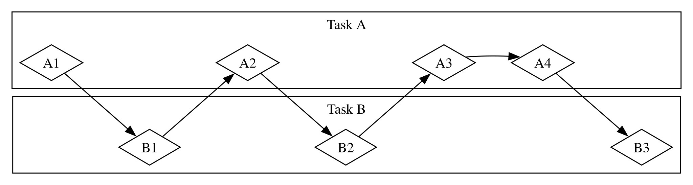
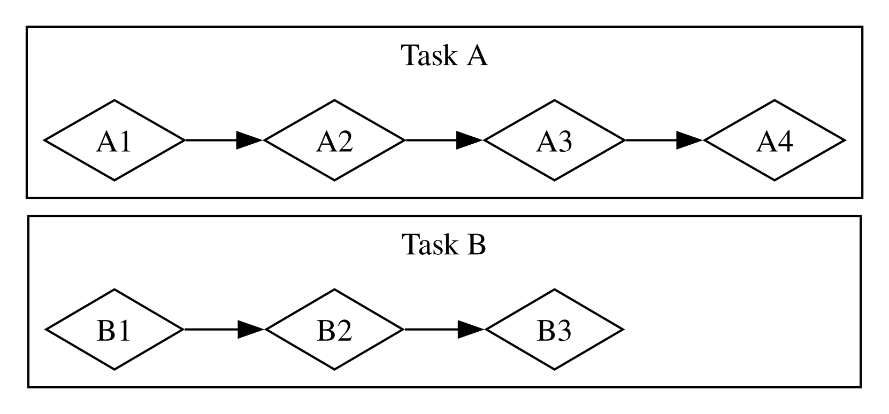
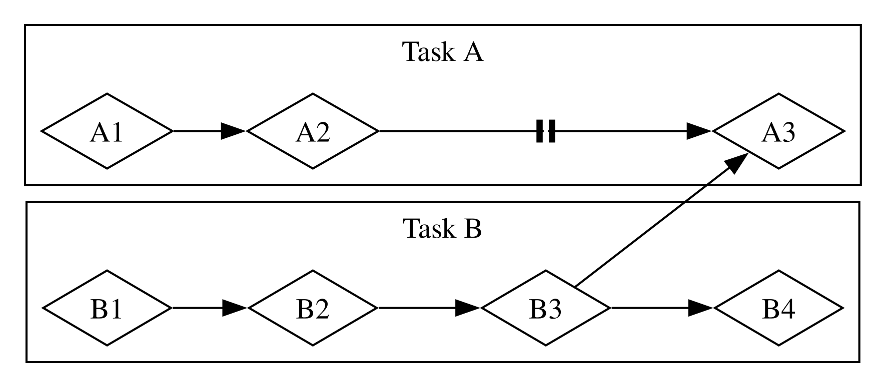

# Fondamentaux de la programmation asynchrone : async, await, futures et flux

De nombreuses opérations que nous demandons à l’ordinateur d’effectuer peuvent prendre du temps. Il serait agréable de pouvoir faire autre chose pendant que ces processus de longue durée s’exécutent. Les ordinateurs modernes offrent deux techniques permettant de travailler sur plusieurs opérations à la fois : le parallélisme et la concurrence. La logique de nos programmes est toutefois écrite de manière essentiellement linéaire. Nous aimerions pouvoir indiquer les opérations qu’un programme doit effectuer et les points où une fonction peut se mettre en pause pour laisser une autre partie du programme s’exécuter, sans avoir à préciser à l’avance l’ordre exact ni la manière dont chaque partie du code doit s’exécuter. La _programmation asynchrone_ est une abstraction qui nous permet d’exprimer notre code en termes de points de pause potentiels et de résultats éventuels, tout en prenant en charge les détails de la coordination.

Ce chapitre prolonge l’utilisation des threads pour le parallélisme et la concurrence présentée au chapitre 16 en introduisant une autre façon d’écrire du code : les futures et les flux de Rust, ainsi que la syntaxe `async` et `await`, qui nous permet d’exprimer la manière dont les opérations peuvent être asynchrones, et les crates tierces qui implémentent des environnements d’exécution asynchrones : du code qui gère et coordonne l’exécution des opérations asynchrones.

Prenons un exemple. Imaginons que vous exportiez une vidéo que vous avez créée à partir d’une fête de famille, une opération qui peut durer de quelques minutes à plusieurs heures. L’exportation vidéo utilisera autant de puissance de calcul du processeur et du GPU que possible. Si votre ordinateur n’avait qu’un seul cœur de processeur et que le système d’exploitation n’interrompait pas l’exportation avant qu’elle soit terminée — autrement dit, s’il exécutait l’exportation de manière _synchrone_ —, vous ne pourriez rien faire d’autre sur votre ordinateur pendant l’exécution de cette tâche. L’expérience serait assez frustrante. Heureusement, le système d’exploitation de votre ordinateur peut interrompre l’exportation de manière invisible, et le fait assez souvent pour vous permettre d’effectuer d’autres tâches en même temps.

Imaginons maintenant que vous téléchargiez une vidéo partagée par quelqu’un d’autre. Cela peut également prendre du temps, mais mobilise moins le processeur. Dans ce cas, le processeur doit attendre que les données arrivent du réseau. Vous pouvez commencer à lire les données dès qu’elles commencent à arriver, mais il faudra peut-être un certain temps avant qu’elles soient toutes disponibles. Même lorsque toutes les données sont présentes, si la vidéo est assez volumineuse, il faudra peut-être une ou deux secondes pour tout charger. Cela peut sembler peu, mais c’est très long pour un processeur moderne, qui peut effectuer des milliards d’opérations par seconde. Là encore, votre système d’exploitation interrompra votre programme de manière invisible pour permettre au processeur d’effectuer d’autres tâches pendant qu’il attend la fin de l’appel réseau.

L’exportation vidéo est un exemple d’opération _limitée par le processeur_ ou _limitée par le calcul_. Elle est limitée par la capacité de traitement des données du processeur ou du GPU de l’ordinateur, ainsi que par la part de cette capacité qu’il peut consacrer à l’opération. Le téléchargement vidéo est un exemple d’opération _limitée par les entrées-sorties_, car il est limité par la vitesse des _entrées et sorties_ de l’ordinateur ; il ne peut pas aller plus vite que la vitesse à laquelle les données peuvent être transmises sur le réseau.

Dans ces deux exemples, les interruptions invisibles du système d’exploitation fournissent une forme de concurrence. Cette concurrence se produit toutefois uniquement à l’échelle de l’ensemble du programme : le système d’exploitation interrompt un programme pour permettre à d’autres programmes d’effectuer leur travail. Dans bien des cas, comme nous comprenons nos programmes à un niveau beaucoup plus détaillé que le système d’exploitation, nous pouvons repérer des possibilités de concurrence que celui-ci ne peut pas voir.

Par exemple, si nous créons un outil de gestion des téléchargements, nous devrions pouvoir écrire notre programme de sorte que le démarrage d’un téléchargement ne bloque pas l’interface utilisateur, et que les utilisateurs puissent lancer plusieurs téléchargements en même temps. Cependant, de nombreuses API de système d’exploitation permettant d’interagir avec le réseau sont _bloquantes_ : elles suspendent la progression du programme jusqu’à ce que les données qu’elles traitent soient entièrement prêtes.

> Remarque : À bien y réfléchir, c’est ainsi que fonctionnent la _plupart_ des appels de fonction. Toutefois, le terme _bloquant_ est généralement réservé aux appels de fonction qui interagissent avec des fichiers, le réseau ou d’autres ressources de l’ordinateur, car ce sont les cas où une opération _non_ bloquante serait bénéfique à un programme donné.

Nous pourrions éviter de bloquer notre thread principal en lançant un thread dédié au téléchargement de chaque fichier. Cependant, la surcharge liée aux ressources système utilisées par ces threads finirait par poser problème. Il serait préférable que l’appel ne bloque pas dès le départ et que nous puissions plutôt définir un certain nombre de tâches que notre programme doit accomplir, puis laisser l’environnement d’exécution choisir le meilleur ordre et la meilleure manière de les exécuter.

C’est précisément ce que nous apporte l’abstraction _async_ (abréviation d’_asynchrone_) de Rust. Dans ce chapitre, vous découvrirez tout ce qu’il faut savoir sur async en abordant les sujets suivants :

- Comment utiliser la syntaxe `async` et `await` de Rust et exécuter des fonctions asynchrones avec un environnement d’exécution
- Comment utiliser le modèle asynchrone pour résoudre certains des mêmes défis que ceux abordés au chapitre 16
- Comment le multithreading et l’asynchrone offrent des solutions complémentaires que vous pouvez combiner dans bien des cas

Avant de voir comment async fonctionne en pratique, nous devons toutefois faire un bref détour pour expliquer les différences entre le parallélisme et la concurrence.

## Parallélisme et concurrence

Jusqu’ici, nous avons traité le parallélisme et la concurrence comme des notions largement interchangeables. Nous devons maintenant les distinguer plus précisément, car leurs différences apparaîtront au fil de notre travail.

Considérons les différentes manières dont une équipe pourrait répartir le travail sur un projet logiciel. Vous pourriez confier plusieurs tâches à une même personne, attribuer une tâche à chaque membre ou combiner les deux approches.

Lorsqu’une personne travaille sur plusieurs tâches différentes avant d’en avoir terminé une seule, il s’agit de _concurrence_. Une façon de mettre en œuvre la concurrence consiste à imaginer que vous avez deux projets différents sur votre ordinateur et que, lorsque vous vous lassez de l’un ou que vous êtes bloqué, vous passez à l’autre. Vous êtes seul, donc vous ne pouvez pas progresser sur les deux tâches exactement au même moment, mais vous pouvez effectuer plusieurs tâches à la fois en progressant sur l’une puis sur l’autre (voir la figure 17-1).

<figure>

<figcaption>Figure 17-1 : Un flux de travail concurrent, avec des passages de la tâche A à la tâche B</figcaption>

</figure>

Lorsque l’équipe répartit un ensemble de tâches en demandant à chaque membre d’en prendre une et de travailler dessus seul, il s’agit de _parallélisme_. Chaque membre de l’équipe peut progresser exactement au même moment (voir la figure 17-2).

<figure>

<figcaption>Figure 17-2 : Un flux de travail parallèle, où les tâches A et B sont effectuées indépendamment</figcaption>

</figure>

Dans ces deux flux de travail, vous devrez peut-être coordonner différentes tâches. Vous pensiez peut-être que la tâche confiée à une personne était totalement indépendante du travail des autres, mais elle nécessite en fait qu’un autre membre de l’équipe termine d’abord sa tâche. Une partie du travail pourrait être effectuée en parallèle, mais une autre doit en réalité être effectuée de manière _séquentielle_ : les tâches doivent se suivre, l’une après l’autre, comme à la figure 17-3.

<figure>

<figcaption>Figure 17-3 : Un flux de travail partiellement parallèle, où les tâches A et B sont effectuées indépendamment jusqu’à ce que la tâche A3 soit bloquée en attendant les résultats de la tâche B3.</figcaption>

</figure>

De même, vous pourriez vous rendre compte que l’une de vos tâches dépend d’une autre de vos tâches. Votre travail concurrent devient alors lui aussi séquentiel.

Le parallélisme et la concurrence peuvent également se recouper. Si vous apprenez qu’un collègue est bloqué jusqu’à ce que vous terminiez l’une de vos tâches, vous vous concentrerez probablement entièrement sur celle-ci afin de « débloquer » votre collègue. Vous et votre collègue ne pouvez alors plus travailler en parallèle, et vous ne pouvez plus non plus travailler simultanément sur vos propres tâches.

Les mêmes dynamiques fondamentales s’appliquent aux logiciels et au matériel. Sur une machine équipée d’un seul cœur de processeur, le processeur ne peut effectuer qu’une seule opération à la fois, mais il peut tout de même travailler de manière concurrente. Grâce à des outils comme les threads, les processus et async, l’ordinateur peut mettre une activité en pause et passer à d’autres activités avant de revenir éventuellement à la première. Sur une machine dotée de plusieurs cœurs de processeur, il peut également effectuer du travail en parallèle. Un cœur peut effectuer une tâche tandis qu’un autre exécute une tâche entièrement différente, et ces opérations ont réellement lieu au même moment.

L’exécution de code asynchrone en Rust se fait généralement de manière concurrente. Selon le matériel, le système d’exploitation et l’environnement d’exécution asynchrone que nous utilisons (nous reviendrons bientôt sur les environnements d’exécution asynchrones), cette concurrence peut également tirer parti du parallélisme en arrière-plan.

Voyons maintenant comment fonctionne réellement la programmation asynchrone en Rust.