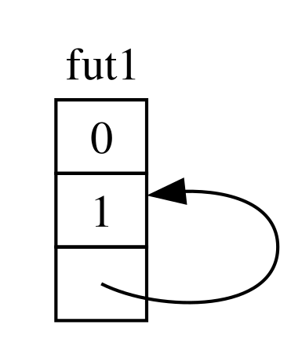
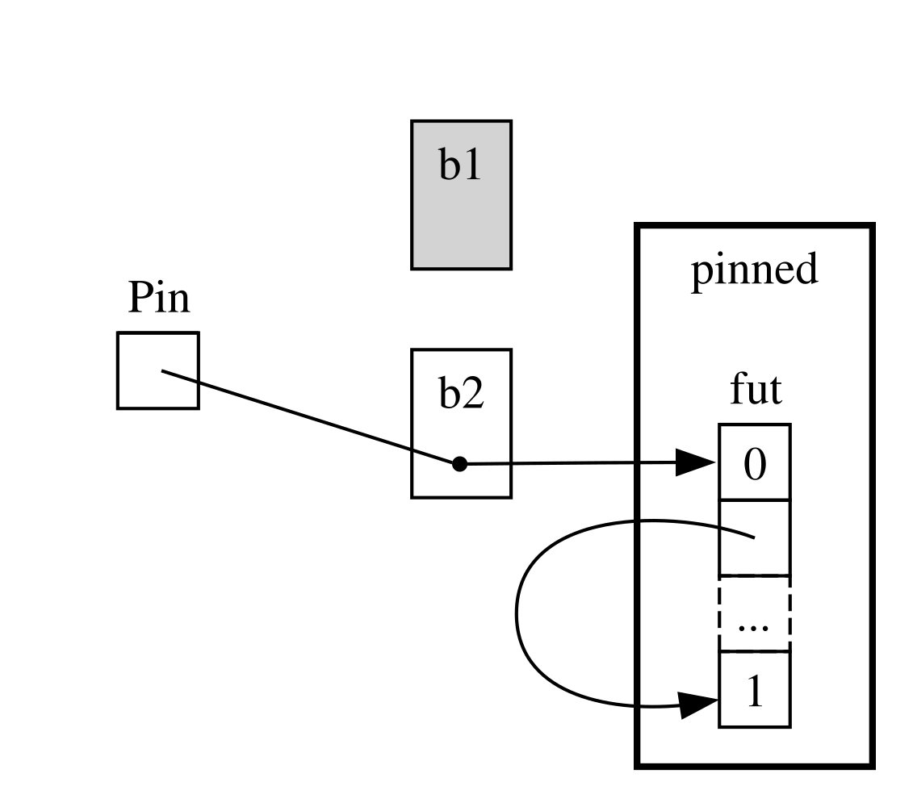
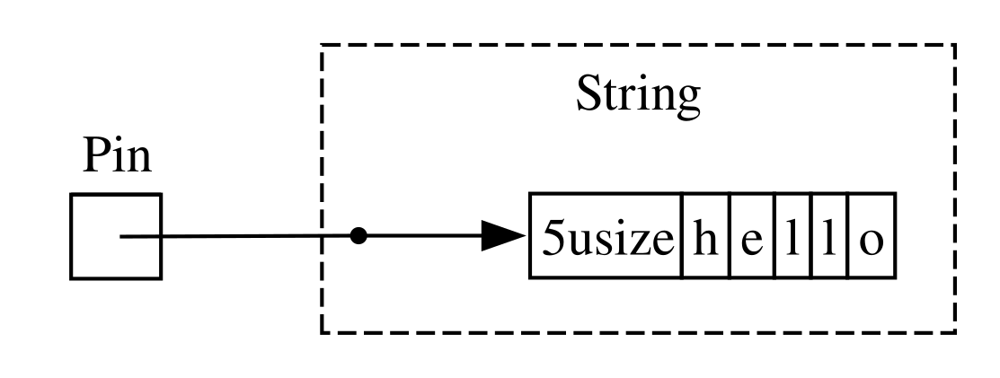
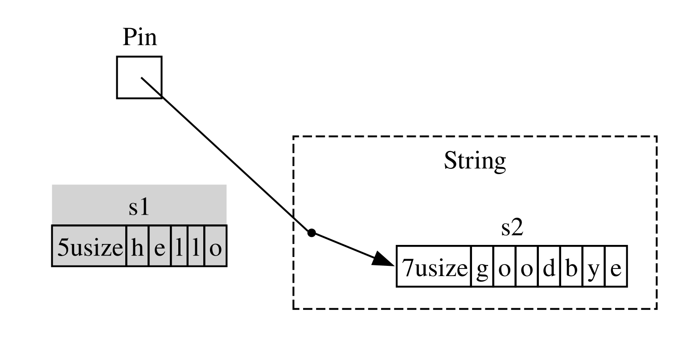

<!-- Old headings. Do not remove or links may break. -->

<a id="digging-into-the-traits-for-async"></a>

## Examinons de plus près les traits pour l’asynchrone

Tout au long de ce chapitre, nous avons utilisé les traits `Future`, `Stream` et `StreamExt` de différentes façons. Jusqu’à présent, nous avons toutefois évité d’entrer trop dans les détails de leur fonctionnement et de leurs interactions, ce qui convient dans la plupart des situations du quotidien en Rust. Il arrive cependant que vous rencontriez des cas où vous devrez comprendre un peu mieux ces traits, ainsi que le type `Pin` et le trait `Unpin`. Dans cette section, nous allons les examiner juste assez pour vous aider dans ces situations, en laissant les explications _vraiment_ approfondies à d’autres documents.

<!-- Old headings. Do not remove or links may break. -->

<a id="future"></a>

### Le trait `Future`

Commençons par examiner de plus près le fonctionnement du trait `Future`. Voici sa définition en Rust :

```rust
use std::pin::Pin;
use std::task::{Context, Poll};

pub trait Future {
    type Output;

    fn poll(self: Pin<&mut Self>, cx: &mut Context<'_>) -> Poll<Self::Output>;
}
```

Cette définition de trait comprend plusieurs nouveaux types, ainsi que quelques éléments de syntaxe que nous n’avons pas encore vus. Examinons-la donc morceau par morceau.

Tout d’abord, le type associé `Output` de `Future` indique ce à quoi aboutit le future. Cela est comparable au type associé `Item` du trait `Iterator`. Ensuite, `Future` possède la méthode `poll`, qui prend pour paramètre `self` une référence spéciale `Pin`, ainsi qu’une référence mutable vers un type `Context`, et renvoie un `Poll<Self::Output>`. Nous parlerons davantage de `Pin` et de `Context` dans un instant. Pour l’instant, concentrons-nous sur le type renvoyé par la méthode, le type `Poll` :

```rust
pub enum Poll<T> {
    Ready(T),
    Pending,
}
```

Ce type `Poll` ressemble à `Option`. Il possède une variante qui contient une valeur, `Ready(T)`, et une autre qui n’en contient pas, `Pending`. Cependant, `Poll` a une signification bien différente de celle d’`Option` ! La variante `Pending` indique que le future a encore du travail à effectuer : l’appelant devra donc vérifier à nouveau plus tard. La variante `Ready` indique que le `Future` a terminé son travail et que la valeur `T` est disponible.

> Remarque : Il est rare d’avoir besoin d’appeler `poll` directement, mais si cela vous arrive, gardez à l’esprit qu’avec la plupart des futures, l’appelant ne doit pas rappeler `poll` après que le future a renvoyé `Ready`. Beaucoup de futures paniquent si on les interroge à nouveau après qu’ils sont prêts. La documentation des futures qui peuvent être interrogés à nouveau sans risque le précise explicitement. Le comportement est comparable à celui de `Iterator::next`.

Lorsque vous voyez du code utilisant `await`, Rust le compile en coulisses en code qui appelle `poll`. Si vous revenez à l’exemple 17-4, où nous affichions le titre d’une page pour une URL dès qu’il était disponible, Rust le compile en quelque chose qui ressemble (sans être exactement identique) à ceci :

```rust,ignore
match page_title(url).poll() {
    Ready(page_title) => match page_title {
        Some(title) => println!("The title for {url} was {title}"),
        None => println!("{url} had no title"),
    }
    Pending => {
        // But what goes here?
    }
}
```

Que devons-nous faire lorsque le future est encore `Pending` ? Il nous faut un moyen de réessayer, encore et encore, jusqu’à ce que le future soit enfin prêt. Autrement dit, il nous faut une boucle :

```rust,ignore
let mut page_title_fut = page_title(url);
loop {
    match page_title_fut.poll() {
        Ready(value) => match page_title {
            Some(title) => println!("The title for {url} was {title}"),
            None => println!("{url} had no title"),
        }
        Pending => {
            // continue
        }
    }
}
```

Si Rust compilait exactement en ce code, toutefois, chaque `await` serait bloquant — exactement le contraire de ce que nous cherchions à obtenir ! À la place, Rust veille à ce que la boucle puisse céder le contrôle à un élément capable de suspendre le travail sur ce future, de travailler sur d’autres futures, puis de vérifier à nouveau celui-ci plus tard. Comme nous l’avons vu, cet élément est un runtime asynchrone, et la planification et la coordination font partie de ses principales tâches.

Dans la section [« Transmettre des données entre deux tâches à l’aide du passage de messages »][message-passing]<!-- ignore -->, nous avons décrit l’attente sur `rx.recv`. L’appel à `recv` renvoie un future, et attendre ce future revient à l’interroger. Nous avons indiqué qu’un runtime suspend le future jusqu’à ce qu’il soit prêt à renvoyer `Some(message)` ou `None` lorsque le canal se ferme. Grâce à notre compréhension plus approfondie du trait `Future`, et plus particulièrement de `Future::poll`, nous pouvons voir comment cela fonctionne. Le runtime sait que le future n’est pas prêt lorsque celui-ci renvoie `Poll::Pending`. À l’inverse, le runtime sait que le future _est_ prêt et le fait avancer lorsque `poll` renvoie `Poll::Ready(Some(message))` ou `Poll::Ready(None)`.

Les détails exacts de ce mécanisme dépassent le cadre de ce livre, mais l’essentiel est de comprendre le fonctionnement de base des futures : un runtime _interroge_ chaque future dont il est responsable et le remet en veille s’il n’est pas encore prêt.

<!-- Old headings. Do not remove or links may break. -->

<a id="pinning-and-the-pin-and-unpin-traits"></a>
<a id="the-pin-and-unpin-traits"></a>

### Le type `Pin` et le trait `Unpin`

Dans l’exemple 17-13, nous avons utilisé la macro `trpl::join!` pour attendre trois futures. Il est toutefois courant de disposer d’une collection, comme un vecteur, contenant un certain nombre de futures qui ne sera connu qu’à l’exécution. Remplaçons le code de l’exemple 17-13 par celui de l’exemple 17-23, qui place les trois futures dans un vecteur et appelle plutôt la fonction `trpl::join_all` — ce code ne compilera pas encore.

<Listing number="17-23" caption="Attendre des futures dans une collection"  file-name="src/main.rs">

```rust,ignore,does_not_compile
{{#rustdoc_include ../listings/ch17-async-await/listing-17-23/src/main.rs:here}}
```

</Listing>

Nous plaçons chaque future dans une `Box` pour en faire des _objets de trait_, comme dans la section « Renvoyer des erreurs depuis `run` » du chapitre 12. (Nous verrons les objets de trait en détail au chapitre 18.) Les objets de trait nous permettent de traiter comme un seul et même type chacun des futures anonymes produits par ces types, car ils implémentent tous le trait `Future`.

Cela peut sembler surprenant. Après tout, aucun des blocs asynchrones ne renvoie quoi que ce soit, donc chacun produit un `Future<Output = ()>`. N’oubliez toutefois pas que `Future` est un trait et que le compilateur crée un enum unique pour chaque bloc asynchrone, même lorsque leurs types de sortie sont identiques. De même que vous ne pouvez pas placer deux structures différentes, écrites à la main, dans un `Vec`, vous ne pouvez pas mélanger des enums générés par le compilateur.

Nous transmettons ensuite la collection de futures à la fonction `trpl::join_all` et attendons le résultat. Toutefois, le code ne compile pas. Voici la partie pertinente des messages d’erreur.

<!-- manual-regeneration
cd listings/ch17-async-await/listing-17-23
cargo build
copy *only* the final `error` block from the errors
-->

```text
error[E0277]: `dyn Future<Output = ()>` cannot be unpinned
  --> src/main.rs:48:33
   |
48 |         trpl::join_all(futures).await;
   |                                 ^^^^^ the trait `Unpin` is not implemented for `dyn Future<Output = ()>`
   |
   = note: consider using the `pin!` macro
           consider using `Box::pin` if you need to access the pinned value outside of the current scope
   = note: required for `Box<dyn Future<Output = ()>>` to implement `Future`
note: required by a bound in `futures_util::future::join_all::JoinAll`
  --> file:///home/.cargo/registry/src/index.crates.io-1949cf8c6b5b557f/futures-util-0.3.30/src/future/join_all.rs:29:8
   |
27 | pub struct JoinAll<F>
   |            ------- required by a bound in this struct
28 | where
29 |     F: Future,
   |        ^^^^^^ required by this bound in `JoinAll`
```

La remarque dans ce message d’erreur nous indique que nous devons utiliser la macro `pin!` pour _épingler_ les valeurs, c’est-à-dire les placer dans le type `Pin`, qui garantit qu’elles ne seront pas déplacées en mémoire. Le message d’erreur indique que l’épinglage est nécessaire parce que `dyn Future<Output = ()>` doit implémenter le trait `Unpin`, ce qui n’est pas le cas pour l’instant.

La fonction `trpl::join_all` renvoie une structure appelée `JoinAll`. Cette structure est générique sur un type `F`, qui doit implémenter le trait `Future`. Attendre directement un future avec `await` épingle implicitement celui-ci. C’est pourquoi nous n’avons pas besoin d’utiliser `pin!` partout où nous voulons attendre des futures.

Cependant, nous n’attendons pas directement un future ici. À la place, nous construisons un nouveau future, `JoinAll`, en transmettant une collection de futures à la fonction `join_all`. La signature de `join_all` exige que les types des éléments de la collection implémentent tous le trait `Future`, et `Box<T>` n’implémente `Future` que si le `T` qu’elle enveloppe est un future qui implémente le trait `Unpin`.

Cela fait beaucoup d’informations à assimiler ! Pour bien comprendre, examinons de plus près le fonctionnement du trait `Future`, et plus particulièrement l’épinglage. Regardez à nouveau la définition du trait `Future` :

```rust
use std::pin::Pin;
use std::task::{Context, Poll};

pub trait Future {
    type Output;

    // Required method
    fn poll(self: Pin<&mut Self>, cx: &mut Context<'_>) -> Poll<Self::Output>;
}
```

Le paramètre `cx` et son type `Context` sont essentiels pour qu’un runtime sache quand vérifier un future tout en restant paresseux. Là encore, les détails de ce fonctionnement dépassent le cadre de ce chapitre, et vous n’aurez généralement besoin d’y réfléchir que si vous écrivez une implémentation personnalisée de `Future`. Nous allons plutôt nous intéresser au type de `self`, car c’est la première fois que nous rencontrons une méthode où `self` est annoté avec un type. Une annotation de type pour `self` fonctionne comme celles des autres paramètres de fonction, mais présente deux différences essentielles :

- Elle indique à Rust quel doit être le type de `self` pour pouvoir appeler la méthode.
- Ce ne peut pas être n’importe quel type. Il doit s’agir du type sur lequel la méthode est implémentée, d’une référence ou d’un pointeur intelligent vers ce type, ou d’un `Pin` enveloppant une référence vers ce type.

Nous reviendrons sur cette syntaxe au [chapitre 18][ch-18]<!-- ignore -->. Pour l’instant, il suffit de savoir que si nous voulons interroger un future afin de vérifier s’il est `Pending` ou `Ready(Output)`, nous avons besoin d’une référence mutable vers son type, enveloppée dans un `Pin`.

`Pin` est un wrapper pour les types semblables à des pointeurs, tels que `&`, `&mut`, `Box` et `Rc`. (Techniquement, `Pin` fonctionne avec les types qui implémentent les traits `Deref` ou `DerefMut`, mais cela revient essentiellement à ne fonctionner qu’avec des références et des pointeurs intelligents.) `Pin` n’est pas un pointeur en soi et ne possède pas de comportement propre, comme le comptage des références de `Rc` et `Arc` ; c’est uniquement un outil dont le compilateur peut se servir pour faire respecter des contraintes sur l’utilisation des pointeurs.

Se rappeler que `await` est implémenté au moyen d’appels à `poll` permet de commencer à expliquer le message d’erreur que nous avons vu plus tôt, mais celui-ci concernait `Unpin`, et non `Pin`. Quel est donc le lien entre `Pin` et `Unpin`, et pourquoi `Future` exige-t-il que `self` soit de type `Pin` pour appeler `poll` ?

Souvenez-vous que, plus tôt dans ce chapitre, nous avons vu qu’une série de points d’attente dans un future est compilée en machine à états, et que le compilateur veille à ce que cette machine à états respecte toutes les règles de sécurité habituelles de Rust, notamment celles concernant l’emprunt et la propriété. Pour cela, Rust examine quelles données sont nécessaires entre un point d’attente et le point d’attente suivant, ou la fin du bloc asynchrone. Il crée ensuite une variante correspondante dans la machine à états compilée. Chaque variante accède aux données dont elle a besoin dans cette partie du code source, soit en prenant possession de ces données, soit en obtenant une référence mutable ou immuable vers elles.

Jusque-là, tout va bien : si nous commettons une erreur concernant la propriété ou les références dans un bloc asynchrone, le vérificateur d’emprunts nous le signalera. Mais lorsque nous voulons déplacer le future correspondant à ce bloc — par exemple, le déplacer dans un `Vec` pour le transmettre à `join_all` — les choses se compliquent.

Déplacer un future — par exemple en l’insérant dans une structure de données pour l’utiliser comme itérateur avec `join_all`, ou en le renvoyant depuis une fonction — revient en fait à déplacer la machine à états que Rust crée pour nous. Contrairement à la plupart des autres types en Rust, les futures créés par Rust pour les blocs asynchrones peuvent contenir des références vers eux-mêmes dans les champs d’une variante donnée, comme le montre l’illustration simplifiée de la figure 17-4.

<figure>



<figcaption>Figure 17-4 : Un type de données autoréférentiel</figcaption>

</figure>

Par défaut, il n’est toutefois pas sûr de déplacer un objet qui contient une référence vers lui-même, car les références pointent toujours vers l’adresse mémoire réelle de ce qu’elles référencent (voir la figure 17-5). Si vous déplacez la structure de données elle-même, ces références internes continueront de pointer vers l’ancien emplacement. Or, cet emplacement mémoire n’est désormais plus valide. D’une part, sa valeur ne sera pas mise à jour lorsque vous modifierez la structure de données. D’autre part — et c’est plus important — l’ordinateur est désormais libre de réutiliser cette mémoire à d’autres fins ! Vous pourriez par la suite lire des données qui n’ont rien à voir.

<figure>


<figcaption>Figure 17-5 : Résultat dangereux du déplacement d’un type de données autoréférentiel</figcaption>

</figure>

En théorie, le compilateur Rust pourrait essayer de mettre à jour toutes les références à un objet chaque fois qu’il est déplacé, mais cela pourrait entraîner un coût important en performances, surtout s’il faut mettre à jour tout un réseau de références. Si nous pouvions plutôt garantir que la structure de données en question _ne se déplace pas en mémoire_, nous n’aurions pas besoin de mettre à jour les références. C’est précisément le rôle du vérificateur d’emprunts de Rust : dans du code sûr, il vous empêche de déplacer un élément tant qu’une référence active pointe vers lui.

`Pin` s’appuie sur ce principe pour nous apporter exactement la garantie dont nous avons besoin. Lorsque nous _épinglons_ une valeur en enveloppant un pointeur vers celle-ci dans `Pin`, elle ne peut plus être déplacée. Ainsi, si vous avez `Pin<Box<SomeType>>`, c’est la valeur `SomeType` qui est épinglée, _pas_ le pointeur `Box`. La figure 17-6 illustre ce processus.

<figure>


<figcaption>Figure 17-6 : Épingler une `Box` qui pointe vers un type de future autoréférentiel</figcaption>

</figure>

En réalité, le pointeur `Box` peut toujours être déplacé librement. Souvenez-vous : ce qui nous importe, c’est que les données qui sont effectivement référencées restent en place. Si un pointeur se déplace, _mais que les données vers lesquelles il pointe_ restent au même endroit, comme dans la figure 17-7, il n’y a pas de problème potentiel. (À titre d’exercice, consultez la documentation des types ainsi que celle du module `std::pin` et essayez de comprendre comment faire cela avec un `Pin` qui enveloppe une `Box`.) L’essentiel est que le type autoréférentiel lui-même ne puisse pas être déplacé, puisqu’il reste épinglé.

<figure>



<figcaption>Figure 17-7 : Déplacer une `Box` qui pointe vers un type de future autoréférentiel</figcaption>

</figure>

Cependant, la plupart des types peuvent être déplacés sans risque, même s’ils se trouvent derrière un pointeur `Pin`. Nous n’avons besoin de nous préoccuper de l’épinglage que lorsque les éléments ont des références internes. Les valeurs primitives, telles que les nombres et les booléens, sont sûres, puisqu’elles n’ont évidemment aucune référence interne. C’est également le cas de la plupart des types que vous utilisez habituellement en Rust. Vous pouvez, par exemple, déplacer un `Vec` sans vous inquiéter. D’après ce que nous avons vu jusqu’ici, si vous avez un `Pin<Vec<String>>`, vous devriez tout faire au moyen des API sûres, mais restrictives, proposées par `Pin`, alors qu’un `Vec<String>` peut toujours être déplacé sans risque si aucune autre référence ne pointe vers lui. Il nous faut un moyen d’indiquer au compilateur qu’il est tout à fait possible de déplacer des éléments dans des cas comme celui-ci — c’est là qu’intervient `Unpin`.

`Unpin` est un trait marqueur, semblable aux traits `Send` et `Sync` que nous avons vus au chapitre 16, et n’a donc aucune fonctionnalité propre. Les traits marqueurs servent uniquement à indiquer au compilateur qu’il est sûr d’utiliser le type qui implémente un trait donné dans un contexte particulier. `Unpin` informe le compilateur qu’un type donné n’a _pas_ besoin de garantir que la valeur en question ne puisse pas être déplacée sans risque.

<!--
  The inline `<code>` in the next block is to allow the inline `<em>` inside it,
  matching what NoStarch does style-wise, and emphasizing within the text here
  that it is something distinct from a normal type.
-->

Tout comme pour `Send` et `Sync`, le compilateur implémente automatiquement `Unpin` pour tous les types dont il peut prouver qu’ils peuvent être déplacés sans risque. Il existe un cas particulier, là encore comparable à `Send` et `Sync`, où `Unpin` n’est pas implémenté pour un type. On le note <code>impl !Unpin for <em>SomeType</em></code>, où <code><em>SomeType</em></code> est le nom d’un type qui doit respecter ces garanties pour rester sûr chaque fois qu’un pointeur vers ce type est utilisé dans un `Pin`.

Autrement dit, il faut garder à l’esprit deux choses concernant le lien entre `Pin` et `Unpin`. Premièrement, `Unpin` est le cas « normal » et `!Unpin` est le cas particulier. Deuxièmement, le fait qu’un type implémente `Unpin` ou `!Unpin` n’a d’importance que lorsque vous utilisez un pointeur épinglé vers ce type, par exemple <code>Pin<&mut
<em>SomeType</em>></code>.

Pour illustrer cela, pensez à une `String` : elle contient une longueur et les caractères Unicode qui la composent. Nous pouvons envelopper une `String` dans `Pin`, comme le montre la figure 17-8. Toutefois, `String` implémente automatiquement `Unpin`, comme la plupart des autres types en Rust.

<figure>



<figcaption>Figure 17-8 : Épingler une `String` ; la ligne en pointillés indique que `String` implémente le trait `Unpin` et n’est donc pas épinglée</figcaption>

</figure>

Par conséquent, nous pouvons effectuer des opérations qui seraient interdites si `String` implémentait plutôt `!Unpin`, comme remplacer une chaîne par une autre au même emplacement en mémoire, comme dans la figure 17-9. Cela ne viole pas le contrat de `Pin`, car `String` ne possède aucune référence interne qui rendrait risqué son déplacement. C’est précisément pour cette raison qu’elle implémente `Unpin` plutôt que `!Unpin`.

<figure>



<figcaption>Figure 17-9 : Remplacer la `String` par une autre `String`, entièrement différente, en mémoire</figcaption>

</figure>

Nous en savons maintenant assez pour comprendre les erreurs signalées par l’appel à `join_all` de l’exemple 17-23. Au départ, nous avons essayé de déplacer les futures produits par des blocs asynchrones dans un `Vec<Box<dyn Future<Output = ()>>>`, mais comme nous l’avons vu, ces futures peuvent contenir des références internes et n’implémentent donc pas automatiquement `Unpin`. Une fois épinglés, nous pouvons transmettre le type `Pin` obtenu au `Vec`, en ayant la certitude que les données sous-jacentes des futures ne seront _pas_ déplacées. L’exemple 17-24 montre comment corriger le code en appelant la macro `pin!` à l’endroit où chacun des trois futures est défini, et en ajustant le type de l’objet de trait.

<Listing number="17-24" caption="Épingler les futures pour pouvoir les déplacer dans le vecteur">

```rust
{{#rustdoc_include ../listings/ch17-async-await/listing-17-24/src/main.rs:here}}
```

</Listing>

Cet exemple compile et s’exécute maintenant, et nous pourrions ajouter ou supprimer des futures du vecteur à l’exécution, puis les attendre tous.

`Pin` et `Unpin` sont surtout importants lors de la création de bibliothèques de bas niveau, ou d’un runtime lui-même, plutôt que dans le code Rust du quotidien. Lorsque vous rencontrez ces traits dans des messages d’erreur, vous aurez maintenant une meilleure idée de la façon de corriger votre code !

> Remarque : Cette combinaison de `Pin` et `Unpin` permet d’implémenter en toute sécurité en Rust toute une catégorie de types complexes qui seraient autrement difficiles à réaliser, car ils sont autoréférentiels. Les types qui nécessitent `Pin` apparaissent aujourd’hui le plus souvent en Rust asynchrone, mais vous pourriez aussi en rencontrer dans d’autres contextes, de temps à autre.
>
> Le fonctionnement précis de `Pin` et `Unpin`, ainsi que les règles qu’ils doivent respecter, sont expliqués en détail dans la documentation de l’API de `std::pin`. Si vous souhaitez en savoir davantage, c’est un excellent point de départ.
>
> Pour comprendre encore plus en détail leur fonctionnement interne, consultez les chapitres [2][under-the-hood]<!-- ignore --> et [4][pinning]<!-- ignore --> de [_Programmation asynchrone en Rust_][async-book].

### Le trait `Stream`

Maintenant que vous comprenez mieux les traits `Future`, `Pin` et `Unpin`, nous pouvons nous intéresser au trait `Stream`. Comme vous l’avez appris plus tôt dans ce chapitre, les flux sont semblables à des itérateurs asynchrones. Cependant, contrairement à `Iterator` et `Future`, `Stream` n’a pas de définition dans la bibliothèque standard à l’heure où nous écrivons ces lignes ; il existe néanmoins une définition très répandue, issue du crate `futures`, qui est utilisée dans tout l’écosystème.

Revenons sur les définitions des traits `Iterator` et `Future` avant d’examiner comment un trait `Stream` pourrait les réunir. Avec `Iterator`, nous avons la notion de séquence : sa méthode `next` fournit un `Option<Self::Item>`. Avec `Future`, nous avons la notion d’état prêt au fil du temps : sa méthode `poll` fournit un `Poll<Self::Output>`. Pour représenter une séquence d’éléments qui deviennent disponibles au fil du temps, nous définissons un trait `Stream` qui réunit ces caractéristiques :

```rust
use std::pin::Pin;
use std::task::{Context, Poll};

trait Stream {
    type Item;

    fn poll_next(
        self: Pin<&mut Self>,
        cx: &mut Context<'_>
    ) -> Poll<Option<Self::Item>>;
}
```

Le trait `Stream` définit un type associé appelé `Item` pour désigner le type des éléments produits par le flux. Cela ressemble à `Iterator`, qui peut produire de zéro à plusieurs éléments, et diffère de `Future`, qui possède toujours une seule sortie `Output`, même si celle-ci est de type unité `()`.

`Stream` définit également une méthode permettant d’obtenir ces éléments. Nous l’appelons `poll_next` pour indiquer clairement qu’elle interroge le flux de la même façon que `Future::poll` et produit une séquence d’éléments de la même façon que `Iterator::next`. Son type de retour combine `Poll` et `Option`. Le type externe est `Poll`, car il faut vérifier si le flux est prêt, comme pour un future. Le type interne est `Option`, car il doit indiquer s’il reste des messages, comme le fait un itérateur.

Il est probable qu’une définition très similaire à celle-ci finisse par intégrer la bibliothèque standard de Rust. En attendant, elle fait partie de la boîte à outils de la plupart des runtimes. Vous pouvez donc vous appuyer dessus ; tout ce que nous verrons ensuite devrait généralement s’appliquer !

Cependant, dans les exemples de la section [« Les flux : des futures en séquence »][streams]<!-- ignore -->, nous n’avons utilisé ni `poll_next` ni `Stream`, mais plutôt `next` et `StreamExt`. Nous pourrions bien sûr travailler directement avec l’API `poll_next` en écrivant à la main nos propres machines à états `Stream`, tout comme nous pourrions travailler directement avec les futures au moyen de leur méthode `poll`. Mais `await` est bien plus pratique, et le trait `StreamExt` fournit la méthode `next` qui nous permet de faire exactement cela :

```rust
{{#rustdoc_include ../listings/ch17-async-await/no-listing-stream-ext/src/lib.rs:here}}
```

<!--
TODO: update this if/when tokio/etc. update their MSRV and switch to using async functions
in traits, since the lack thereof is the reason they do not yet have this.
-->

> Remarque : La définition réelle utilisée plus tôt dans le chapitre est légèrement différente, car elle prend en charge les versions de Rust qui ne permettaient pas encore l’utilisation de fonctions asynchrones dans les traits. Elle se présente donc ainsi :
>
> ```rust,ignore
> fn next(&mut self) -> Next<'_, Self> where Self: Unpin;
> ```
>
> Le type `Next` est une `struct` qui implémente `Future` et nous permet de nommer la durée de vie de la référence à `self` avec `Next<'_, Self>`, afin que `await` puisse fonctionner avec cette méthode.

Le trait `StreamExt` regroupe également toutes les méthodes intéressantes disponibles pour les flux. `StreamExt` est implémenté automatiquement pour chaque type qui implémente `Stream`, mais ces traits sont définis séparément afin que la communauté puisse faire évoluer les API pratiques sans affecter le trait fondamental.

Dans la version de `StreamExt` utilisée par le crate `trpl`, le trait ne définit pas seulement la méthode `next` ; il fournit aussi une implémentation par défaut de `next` qui gère correctement les détails de l’appel à `Stream::poll_next`. Cela signifie que, même si vous devez écrire votre propre type de données de flux, vous n’avez _qu’à_ implémenter `Stream` ; toute personne utilisant votre type de données pourra alors utiliser automatiquement `StreamExt` et ses méthodes.

Nous avons terminé notre examen des détails de bas niveau de ces traits. Pour conclure, voyons comment les futures (y compris les flux), les tâches et les threads s’articulent !

[message-passing]: ch17-02-concurrency-with-async.md#sending-data-between-two-tasks-using-message-passing
[ch-18]: ch18-00-oop.html
[async-book]: https://rust-lang.github.io/async-book/
[under-the-hood]: https://rust-lang.github.io/async-book/02_execution/01_chapter.html
[pinning]: https://rust-lang.github.io/async-book/04_pinning/01_chapter.html
[first-async]: ch17-01-futures-and-syntax.html#our-first-async-program
[any-number-futures]: ch17-03-more-futures.html#working-with-any-number-of-futures
[streams]: ch17-04-streams.html