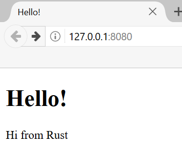

# Projet final : création d’un serveur web multithread

Le chemin a été long, mais nous sommes arrivés à la fin du livre. Dans ce
chapitre, nous allons réaliser ensemble un dernier projet afin d’illustrer
certains des concepts abordés dans les derniers chapitres, ainsi que de revenir
sur quelques leçons précédentes.

Pour notre projet final, nous allons créer un serveur web qui affiche « Hello! »
et ressemble à la figure 21-1 dans un navigateur web.

Voici notre plan pour créer le serveur web :

1. En apprendre un peu plus sur TCP et HTTP.
2. Écouter les connexions TCP sur un socket.
3. Analyser un petit nombre de requêtes HTTP.
4. Créer une réponse HTTP correcte.
5. Améliorer le débit de notre serveur à l’aide d’un pool de threads.

Figure 21-1 : notre projet commun final

Avant de commencer, nous devons préciser deux choses. Premièrement, la méthode
que nous allons utiliser ne sera pas la meilleure façon de créer un serveur web
avec Rust. Des membres de la communauté ont publié sur
[crates.io](https://crates.io/) de nombreuses crates prêtes pour la production
qui fournissent des implémentations de serveurs web et de pools de threads plus
complètes que celles que nous allons créer. Cependant, notre objectif dans ce
chapitre est de vous aider à apprendre, et non de choisir la facilité. Rust
étant un langage de programmation système, nous pouvons choisir le niveau
d’abstraction avec lequel nous voulons travailler et descendre à un niveau plus
bas que ce qui est possible ou pratique dans d’autres langages.

Deuxièmement, nous n’utiliserons pas async et await ici. Créer un pool de
threads est déjà un défi de taille, sans en plus devoir créer un runtime async !
Nous verrons toutefois comment async et await pourraient s’appliquer à certains
des mêmes problèmes que nous allons rencontrer dans ce chapitre. En fin de
compte, comme nous l’avons mentionné au chapitre 17, de nombreux runtimes async
utilisent des pools de threads pour gérer leur travail.

Nous allons donc écrire manuellement le serveur HTTP de base et le pool de
threads afin que vous puissiez découvrir les idées et les techniques générales
qui sous-tendent les crates que vous pourriez utiliser à l’avenir.